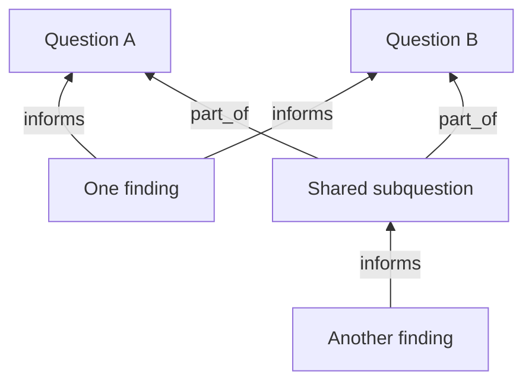

# Question discovery and overlapping research

Status: proposed architecture. This document does not change the running worker
or add scientific records. The user requested question discovery, findings that
relate to multiple questions, and a pass that discovers those relationships.

## Recommendation

Keep one shared evidence graph and the existing local Qwen process. Add
`question` and `overlap` roles to the default rotation. Each role starts with
fresh instructions and a bounded packet of original evidence. Workers save
proposals through the same durable recording path. Questions guide scheduling;
they do not own copies of findings.

A finding can inform several questions. A method can address several questions.
An experiment can test several questions. A specific question can be part of
several broader questions when it is actually a subproblem of each. General
overlap is visible through shared records and does not require a new generic
`related_to` predicate.

The shared nodes retain one ID, one source account, and one Obsidian note.
Multiple parents are allowed; cycles and self-links in `part_of` are rejected.
Other kinds of graph cycles can be meaningful and are not prohibited globally.

## What the repository already supports

- `workbench/validation.py` already accepts `informs` from claim to question,
  `addresses` from approach to question, `tests` from experiment to question,
  and `part_of` from question to question. There is no single-parent constraint.
- `research_context.select_context` already searches the whole local snapshot
  and can include multiple relations for a candidate.
- `ResearchInbox.record` can create a question with several outgoing parent
  links. However, its draft format can only create links originating at the
  newly created item. It cannot connect two existing records or attach existing
  findings to a new question in the reverse direction.
- `ResearchRunner.prepare_draft` attaches an extraction to one question, and
  paper jobs are keyed by question plus publication.
- `ConnectionWorker._select` groups candidate findings by the original job's
  question ID. It currently cannot discover comparisons across those groups.
- `bound_candidate` and `bound_connection` compare all current outgoing links
  against the original draft. Additional legitimate links would fail these
  integrity checks. This must be fixed before overlap workers write links.

## Alternatives considered

| Approach | Tradeoff |
| --- | --- |
| Give the existing researcher responsibility for questions and all links | Smallest prompt change, but mixes extraction, question quality, and relationship judgment. Historical findings get little attention. |
| Give one general graph editor unrestricted edit proposals | Flexible, but combines several review criteria and makes errors harder to attribute and constrain. |
| Add question and overlap passes sharing evidence and recording modules | Recommended. Each pass has a specific output, separate review criteria, and measurable results. Existing findings receive dedicated attention. |

## The five roles

| Role | Job | Durable result |
| --- | --- | --- |
| `research` | Investigate an eligible question and inspect publications. Reuse existing findings when the same scoped assertion has already been captured. | A proposed sourced finding or a proposed additional question link. |
| `audit` | Reassess original source support, later relationships, and the premises of generated questions. | An attributed assessment; scheduling/context eligibility is recomputed separately. |
| `question` | Find a specific unresolved gap, tension, or missing measurement in eligible evidence. Compare against existing questions. | At most one new question with its motivation, evidence, useful outcome, parent links, and links from supporting findings. |
| `overlap` | Compare existing findings, methods, and experiments against other questions, including newly created questions. | At most three separately justified additional links per turn; no duplicate finding. |
| `connect` | Compare evidence across question neighborhoods as well as within them. | A proposed synthesis with its own evidence and links, only when there is a substantive new interpretation. |

Start with a default rotation of `research → audit → question → overlap →
connect`. Retain explicit role overrides and the existing single-model
execution, stop checkpoints, saved jobs, and recovery behavior.

Question and overlap passes can return “nothing useful.” They are not required
to manufacture an output. Question discovery uses source-supported findings or
reviewed source passages; it does not interpret an unsupported claim as an
established premise. A rejected claim may motivate an audit, not a chain of
new scientific conclusions.

## A narrow graph-recording operation

Add `ResearchInbox.record_graph(proposal, session_id)` beside the existing
`record` API. Initially support exactly the two required proposal shapes:

1. One new question plus explicit relations between that question and existing
   records.
2. A bounded batch of relations between existing records.

Each proposal carries a stable idempotency key, scoped evidence/rationale per
relation, input record digests, and the model/review receipt supporting its
selection for recording. The recorder derives IDs and capture attribution;
model output does not supply session identity or scientific review status.
For a question proposal, local references to its new question resolve to its
deterministic ID within the same submission.

Use a separate versioned append-only graph-draft journal, merged into
`ResearchInbox._inputs`. Leave existing version-one draft entries and saved
publication versions unchanged. A proposal is one journal entry, so a question
and its initial links are captured together. Publication is refreshed once
for the batch. Extend the CLI/MCP with the matching graph-recording operation
and the existing saved-versus-published receipt semantics.

Validate every endpoint, kind/predicate combination, source locator, duplicate
edge, and `part_of` cycle before capture. Recheck input digests and eligibility
under the inbox lock immediately before append; a changed input is held for a
fresh assessment. A retry of the same proposal returns the original receipt.
Duplicate relationship checks run under the same lock, preventing two workers
from adding the same current relationship independently. Corrections retain
the prior account and append a new assessment or superseding proposal.

Keep journal capacity bounded and report item and relation counts separately.
An additional relationship must not consume a fake claim or duplicate the
finding it connects. Full snapshot publication should occur once per completed
batch, since publication already rebuilds the selected views.

## Separate evidence integrity from later relationships

Change original-job validation to identify the exact relations created by that
job, using their recorded IDs. Verify those original relations, the immutable
claim, source metadata, and quoted passages exactly. Do not weaken this to a
subset search for any conveniently matching edges.

Additional relations have their own capture provenance, source/input digests,
and assessment. A later bad relationship can become ineligible without
invalidating an otherwise supported original finding. Conversely, a rejected
finding cannot become eligible again through a new link.

Question review asks whether the motivating gap is grounded, distinct, scoped,
and investigable. It does not ask whether the unanswered question is “true.”
Relationship review asks why the particular finding informs the particular
question; shared vocabulary alone is insufficient. Reviewers receive the
candidate plus original attributed excerpts in fresh model calls. Every
accepted automated item and relationship retains scientific status `proposed`.

When a premise loses support, suspend the dependent work and reevaluate it.
Retain the historical question and links. A question with other valid grounds
can remain useful; do not automatically declare it false or erase it. Original
source observations and generated interpretations remain distinguishable when
assembling future packets, preventing a repeated synthesis from becoming
independent evidence for itself.

## Discovery and overlap selection

Question candidates must specify a concrete uncertainty, the records that
motivated it, the relevant population/system/method scope, and what observation
would advance the answer. “Unresolved” is scoped to the inspected evidence and
local graph; it is not a claim that nobody has answered the question elsewhere.
Require a question-comparison step covering existing
and queued questions. Similar titles are candidate matches, not sufficient
evidence of equivalence. Keep duplicates linked to the existing question in
the worker job result rather than creating another graph node.

Overlap operates in both directions: a new record triggers comparison with
existing questions; a new question triggers a bounded scan of older records.
A persisted cursor also backfills older record/question pairs. Store the exact
inputs and assessed or rejected candidates so unchanged pairs are not repeatedly
submitted. Changed evidence, question scope, or review revision can make a pair
eligible for reconsideration.

Shortlist using current lexical/facet retrieval, existing neighbors, and a
small rotating sample outside the nearest neighborhood. Then ask the model
to assess a bounded packet. Preserve full required excerpts and their locators
within the existing context budget. Do not compare every record with every
question in a single model request. Add embedding retrieval only if inspected
misses demonstrate that the initial shortlist is inadequate.

The connective pass should use current eligible question relations rather than
the immutable search-job question as ownership. Permit selected comparisons
across neighborhoods without requiring an overlap edge to exist first. The
original search question remains provenance.

Reuse publication identities and cached excerpts across questions. Before
recording an extraction from an already-read publication, check whether its
scoped assertion is already present; if so, propose another `informs` edge.
A single paper can contain distinct findings, so publication identity alone
must never merge two different assertions.

## An agenda separate from scientific status

Automatically generated questions that pass review enter the research agenda.
Use operational states such as `queued`, `active`, `parked`, and
`needs_reassessment`; keep scientific `proposed`/`reviewed` status separate.

Initial defaults: at most 12 active questions, including the two existing seed
questions. Keep the seeds pinned. Queue additional useful questions and use
age plus recent research progress to rotate the other slots fairly. Every
eligible active question gets a turn; the large seed neighborhoods do not
receive priority merely because they already have many findings. A new
question becomes schedulable after its overlap pass has attempted to attach
existing evidence, even if that pass found no additional link.

Bound question creation to one candidate per question turn and do not spawn
further generations from a new question before it has received a research
turn. Lack of new evidence may park a question; it never marks it answered.
Persist agenda state and respect operator-selected question/role restrictions.

The proposed numeric defaults are configurable. Evaluate them through useful
outputs, queue age, new-question coverage, rejected duplicates, accepted and
later-rejected links, and model/publication time. Raw node and edge counts are
insufficient measures of research progress.

## Views and the human graph

Question relevance and Lighthouse publication membership are different
decisions. A local edge may cross two question neighborhoods without
automatically adding either endpoint to a new publication view. The question
worker explicitly chooses from the existing configured views; recording does
not change publication grants or expand them through graph traversal.

Obsidian retains one human-named note for each record. A finding lists all
questions it informs, with a separate reason and assessment for each link.
Questions show their broader questions, subquestions, shared findings, and
agenda state. Existing type colors continue to apply. Shared findings form
visible bridges between neighborhoods without duplicating their notes.

## Implementation order and acceptance

1. Add relation-only and question-with-links capture, atomic replay, and
   per-relation review binding. Preserve version-one drafts and receipts.
2. Add the overlap pass and exercise it on existing evidence. Verify a single
   finding can inform two questions without changing its original source audit.
3. Add question discovery, duplicate assessment, and the bounded agenda.
   Verify a useful generated question receives both overlap and research turns.
4. Let the connective pass select across question neighborhoods; update the
   default rotation, status output, and Obsidian question sections.
5. Run a bounded real-Qwen trial on a copied graph, inspect its questions and
   links, then enable the new defaults on the live worker.

Acceptance includes crash-after-capture replay with no duplicates, stale-input
rejection, reversed/invalid relationship rejection, multiple parents with no
`part_of` cycle, no duplicate question from paraphrasing, independent invalidation
of a bad additional link, negative-premise propagation, backlog progress, fair
scheduling after restart, no implicit publication-scope expansion, and one
Obsidian note shared across question neighborhoods. Real-model trials must be
allowed to produce zero new questions or links when the evidence does not
justify them.

Likely code seams are a graph-proposal module called by `automation.py`, a
shared evidence-packet module extracted from the existing connector/auditor,
`research_questions.py` for discovery and agenda behavior, and
`research_overlap.py` for relevance proposals and backfill. Extend the existing
rotation and model methods directly; a generic plugin or multi-agent framework
is unnecessary for these five concrete roles.
