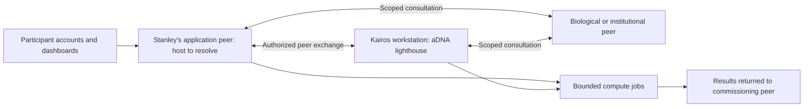

# Personal agents and medical lighthouses: proposed deployment plan

Created: 2026-09-11. Updated: 2026-09-12. Status: revised for one complex patient case, both uploads and medical-record connections, and peer-to-peer operation using aDNA, with Stanley's Raspberry Pi as his lighthouse and local account/onboarding administration. This is a planning document, not an executable implementation specification.

## Purpose

Give each participating patient, family member, doctor, and specialist a personal agent with persistent context, access to their authorized information, and communication suited to them. Let people talk with their agents, let agents collaborate within explicit delegations, and let participants work with Kairos to commission and direct research tasks. Biological lighthouses supply enduring research perspectives that these personal agents can consult.

Preserve the evidence, scope, disagreements, and history behind each interpretation. Produce an understandable shared research workspace and a dossier people can continue after the hackathon and the week of cluster access. A person's ability to pause or leave should not erase their contributions or require them to repeatedly explain their situation.

The confirmed first pilot investigates **one complex patient case**, within the Singapore hackathon's user-reported focus on **myasthenia gravis and complex disease**. The proposed care circle is a patient, a chosen family member, a clinician, and a specialist, with Kairos facilitating research orchestration. The patient's identity, their priorities, and the specific unresolved clinical/research question have not been supplied here; the stated focus does not establish any individual's diagnosis. Use synthetic participant data and a public literature packet for initial software checks. Specific biological assignments and computational analyses depend on the selected question and data.

Both **uploads and medical-record connections are first-version requirements**. No particular aDNA/LatLab API or integration point is mandated. Kairos reports that Stanley's plans and notes are in the lattice on his Pi; reading those existing records is the next design input before choosing new integration interfaces.

Peer-to-peer operation and use of aDNA are user requirements. The earlier proposal for a single shared case collection is superseded: each peer retains its own origin, authority, records, and local case view. Stanley can host accounts for participants who choose his lighthouse without becoming the administrator of the whole network.

## aDNA and the physical first peer

Stanley's lighthouse is a Raspberry Pi 5 with 16 GB RAM, connected to Kairos's router and now verified through authenticated inspection. The initially proposed peer pair was that Pi and Kairos's workstation. The physical host for Stanley's data-bearing application peer must now be reconciled with the Pi's existing Nebula discovery/relay role, described below. The first application demonstration must still exchange a scoped account between independently identified peers and preserve both origins.

**SSH access is verified as of 2026-09-12.** After Kairos had the existing Pi Claude Code session add the Mac's public key, `ssh -o IdentitiesOnly=yes -i ~/.ssh/personal andy@smart.local` authenticated successfully. The LAN address remains `192.168.50.111`; login is `andy`, hostname `smart`, home `/home/andy`. Hardware reports Raspberry Pi 5 Model B Rev 1.1 / Linux aarch64, with about 15 GiB reported RAM and a 939 GiB NVMe filesystem. Earlier failed username/key attempts are historical, not a current blocker. No passwords were tried. The Pi's previously observed ED25519 host key was verified and saved in the Mac's `known_hosts` for hostname and LAN address; its fingerprint is `SHA256:VJq5KSapTy7U0Bb+Snzz1N9j51cJWUgY6io+0kA0Xt4`.

The live service is **`nebula-1043-dd.service`**, described as a drug-discovery lighthouse, with interface `nebula43dd` at **`10.43.0.16`** and command `/usr/local/bin/nebula -config /etc/nebula-1043-dd/config.yml`. Systemd reports it active since 2026-08-04. UDP 4244 and SSH TCP 22 are listening. This establishes a running service and interface, not verified mesh handshakes or reachability from Singapore. No web account/dashboard or LatLab service was demonstrated.

The installed project is `/home/andy/aDNA/Nebula.aDNA`, observed clean at revision `3ea749a54f2eb0632c290c6be3e8db00326e98b9`. Its June manifest/state/campaign describe an unfinished plan for **`10.43.0.11`**, `nebula-1043.service`, and `/etc/nebula-1043/`. Follow-up exploration recovered July/August setup documents outside that project which specify the running **`10.43.0.16` / `nebula-1043-dd`** configuration, together with the Pi's saved setup-session history. They describe the Pi as a program relay with compute elsewhere on the mesh. Treat all setup procedures as history, not commands to replay. See [the session handoff](../HANDOFF.md) for source paths and captured notes.

That exploration also recovered exact MG artifact names in a March template inventory; their document bodies are absent from the Pi. Public aDNA coordination notes point to Stanley-side `RareHarness.aDNA` and `RareArchive.aDNA` vaults. The related [Rare Archive codebase](https://github.com/Wilhelm-Foundation/rare-archive/tree/8b8d4d0a62bf185e36d47aa12556b1abc18edf2c), at an April 2 revision when inspected, describes clinical tools, clinician feedback, training, and MG within its neuromuscular work. Its README still lists multi-site federation as planned. This is relevant existing work, not verification of a deployed patient-agent service or the current Singapore plan. The actual clinical vaults and current case priorities remain to be located.

**Hosting question exposed by the existing plans:** the June campaign states “A lighthouse is non-data-bearing” and assigns network governance to upstream `Network.aDNA` (Venus). It uses *lighthouse* for Nebula discovery/relay infrastructure. Superyak's *Lighthouse* is semantic interchange/publishing. The earlier proposal to put participant accounts and medical records on this physical Pi remains provisional; select a suitable application host or reconcile the intended role explicitly. Authenticated read-only inspection did not change any Pi service, configuration, keys, or lattice file.

The initial suggestion that shell history contained saved Pi usernames was incorrect: a too-broad match had extracted fragments of email addresses. Searches of nine local Engram stores found no matching Pi setup account. An older Mac transcript contained only a session-listing title; the follow-up Pi inspection now recovered the actual local setup transcripts under `/home/andy/.claude/projects/-home-andy-aDNA/`. Their historical success reports remain distinct from current service and connectivity checks.

GitHub inspection confirmed access to `aDNA-Network/aDNA`. Its [L1 upgrade guide](https://github.com/aDNA-Network/aDNA/blob/dea4ab9d4eb7242c832a6311a6e08d85a5791f8c/.adna/how/skills/skill_l1_upgrade.md) describes Nebula mesh connectivity, optional SSH relay tunnels, and the `LatticeProtocol/latlab` runtime with JupyterHub/account setup. The current GitHub login could not resolve/access that runtime repository. Treat these as existing components to inspect before building replacements; the macOS-oriented guide is not an instruction to reinstall the Pi. No mesh configuration, keys, accounts, or services were changed during discovery.

The local [aDNA checkout](../../kinn/aDNA/README.md) organizes each project through `who/`, `what/`, and `how/`. Its [federation guide](../../kinn/aDNA/.adna/what/context/adna_core/context_adna_core_federation.md) defines source instances, `lattice://` references, validation/export/share/import/composition, and explicit port/data mappings. Its [reference](../../kinn/aDNA/.adna/what/docs/adna_reference.md) identifies `.lattice.yaml` as authoritative for lattices and `.canvas` as a view/interaction layer. These are inspected local documentation claims; the Pi's installed versions and executable federation services remain to be checked.

Use aDNA as the project and workflow structure on each peer:

- `who/`: participants, organizations, declared roles, and coordination. Runtime authorization enforces grants; a Markdown declaration alone cannot grant access.
- `what/`: located evidence, datasets, biological accounts, decisions, and lattice definitions. Protected clinical originals stay in access-controlled storage referenced by the appropriate records.
- `how/`: research tasks, workflows, sessions, delegations, and reproducible operations.

Represent cross-peer tasks using source-qualified references and explicit mappings at the boundary. Prefer external references for the pilot so a recipient can use a peer's published interface without merging its internal collection. A `shareable` lattice or publication does not authorize unrestricted disclosure of runtime patient data. Keep executable workflow metadata and protected task inputs separately governed.

The dashboard presents and edits the same aDNA-backed records through validated operations. Atlas provides evidence capture/review capabilities and Engram provides working memory through adapters; both must preserve the peer's aDNA identities and attribution. Exact record mappings need conformance examples before implementation. The existing Hyper-to-aDNA fixture bridge is not a complete medical or network adapter.

Continue from the verified SSH connection: locate Stanley's actual research plans and any newer records for the running Nebula service, retaining paths, authorship, and revisions. Read-only layout, hardware, storage, and service inspection has begun; the historical configuration is not a current deployment recipe. SSH reachability establishes neither application federation nor access from Singapore. Verify authenticated reachability between the actual peers, including the intended remote location, using the installed transport if suitable. A discovery service or relay may assist delivery but must not become the owner of peer identities or research records.

## What exists

Local code and guides inspected on the date above:

- Superyak's Engram runtime archives original exchanges, retrieves context, preserves corrections, and records selected-source manifests. Its subscription adapter spends the existing Codex allowance and cannot strictly account for every internal model call. See [dynamic context](../engram/docs/dynamic-context.md).
- Superyak now accepts explicitly selected aDNA projects as attributed, bounded, read-only context in chat and coding. Its lattice adapter accepts the native `lattice:` envelope, retains external references and named ports, and exports verifiable projections. This is local integration, not authenticated Pi access or medical-record ingestion. See [aDNA compatibility](adna-compatibility.md), implemented in local commit `b01c475`.
- Atlas already rotates through `research`, `audit`, `question`, `overlap`, and `connect` in fresh calls to one model. Records remain scientifically proposed. See [worker roles](../../atlas-workbench/docs/research-worker-roles.md) and `atlas-workbench/workbench/research_workers.py`.
- Atlas has attributed draft capture, scoped source evidence, correction history, and negative assessments that affect subsequent eligibility. See [research recording](../../atlas-workbench/docs/research-recording.md).
- Atlas's Lighthouse adapter publishes selected views of a common origin. It preserves publisher-qualified accounts without merging them. Different origins currently return `unmapped`; there is no implemented cross-origin correspondence. See [Atlas Lighthouse](../../atlas-workbench/docs/lighthouse.md).
- `atlas-workbench/workbench/research_service.py` takes an exclusive project worker lock. Launching several copies against that project is not supported parallel execution.
- `atlas-workbench/workbench/research_model.py` accepts a loopback Ollama HTTP endpoint. A remote cluster inference service cannot simply replace that URL. A worker can instead run beside a compatible server, or a separately reviewed transport adapter can be added.
- Superyak's [session messaging](codex-sessions.md) connects local Codex sessions under one account. It is not a remote, authenticated messaging system for different patients and clinicians. A personal-agent service needs its own participant identity, authorization, transport, and access isolation.

Multiuser medical ingestion, per-person access isolation, and the participant display described below are proposed additions. Existing local threads and named memory instances are not evidence of a secure multiuser service. Earlier Superyak hands-on work also encountered retrieval misses and live service/database failures; reliability belongs in the pilot's acceptance checks.

## Accounts, dashboards, and Stanley's administration

Use invitation-based accounts on Stanley's application peer for participants choosing it as their host; its physical placement remains to be reconciled with the Pi's network role. Stanley is that application's administrator: he can invite participants, help them finish setup, manage local organizational roles, and see local operational status. Peer administrators govern their own systems. Any recovery delegation to Kairos must be configured on the particular peer; there is no network-wide owner account. Stanley can delegate onboarding to another organizer so participants can continue getting help when he is unavailable. These are planned roles; no accounts or invitations have been created.

Each participant receives an individual account, personal dashboard, and persistent agent identity qualified by its issuing peer. Login identity, participant role, case membership, and permission to particular information remain distinct. A person may have several roles in different cases without duplicating their account. Cross-peer identity associations require an explicit verified mapping; matching email addresses or display names do not establish equivalence. The agent records whose account initiated a task and which case/delegation applies.

| Dashboard | Initial contents and controls |
| --- | --- |
| Participant | Personal agent, resume setup, information and timeline, authorized cases, questions, active tasks, results, sharing settings, and help |
| Stanley / administrator | Invite or suspend accounts, assign organization roles, see invitation/setup state, respond to help requests, delegate onboarding, inspect service health and aggregate resource use |
| Kairos / research facilitator | Authorized research requests, participant-requested orchestration help, agent teams, job progress, evidence review, and compute budgets |

The admin dashboard shows the minimum operational information needed for support. Organization administration does not automatically grant access to private medical records or agent conversations. Case access requires a separate grant from someone authorized to give it. Any support session that opens a participant's content is explicitly scoped and visible to that participant; support actions retain the administrator's attribution. Recovery restores the participant's ability to sign in without impersonating them or silently changing sharing settings.

### First onboarding flow

1. Stanley creates an invitation for a participant, selects an initial organizational role, and optionally proposes a case association. The invitation contains no medical information and uses an expiring, single-use acceptance link. He can revoke or replace a pending invitation.
2. The participant accepts and establishes their own sign-in. Stanley does not choose or distribute reusable passwords. The account is linked to a stable internal identity; email changes do not create another person record.
3. The participant confirms their display name, role, communication preferences, and what they want help with. Role labels alone do not certify clinical credentials or grant case access.
4. Their dashboard introduces their agent and shows any case invitation and sharing choices. They can begin with a question and add information later. Case invitations remain requests until the required access grants and acceptance are recorded.
5. They upload a first document or add a note, inspect its extracted account, and try one task. Setup saves after each step and can resume later.
6. The participant can request Stanley's help or ask Kairos to organize research agents. The help request includes only the context they choose to share. Stanley sees setup state and the request, not the contents of unfinished private work.

Suggested account states are invited, active, and suspended, with onboarding progress tracked separately. Suspending an account revokes active sessions and its running agent delegations while preserving records and their attribution. Removing an organizational role does not rewrite prior contributions. Invitation, role, membership, recovery, and access changes retain actor and time in an administrative history.

The first product demonstration should complete this path: Stanley invites a participant; the participant signs in, reaches their own dashboard, meets their agent, adds and corrects one item, and requests one research task. It should also show Stanley helping a second participant resume setup without opening either participant's private information.

## Personal agents and participant control

Each person gets a persistent agent profile and a private workspace. The profile contains preferences they can inspect and correct: preferred language and detail, communication/accessibility needs, declared expertise, goals, relevant history, and standing task permissions. Personalization begins with context and preferences; the first pilot requires no per-person model training.

| Participant | Example assistance |
| --- | --- |
| Patient | Assemble their history, preserve their priorities, explain findings, collect questions, and prepare for conversations |
| Family member | Keep their observations and caregiving constraints, help with coordination, and contribute authorized information |
| Doctor | Review a concise longitudinal account, inspect original evidence, flag inconsistencies, and request bounded research |
| Specialist | Examine the case through their expertise, identify missing measurements, and challenge cross-disciplinary interpretations |
| Kairos / research facilitator | Help participants define tasks, assemble temporary agent teams, inspect results, and manage resource budgets |

The agent can offer its own interpretation, clearly attributed as generated. A direct human statement, a person-approved summary, and an unconfirmed agent inference must remain distinguishable in storage, messages, and the display. Family observations keep the family member's attribution; clinical observations keep their clinical source. The system must support disagreement without requiring a single reconciled story.

A clinician's agent can work across authorized cases, but each case has separate working context and retrieval access. Agent identity does not confer credentials or extend the person's actual access. A family relationship alone does not grant access to another person's information.

People can delegate recurring work within a visible scope, inspect what happened, change permissions, pause tasks, and export their information. They should not need to approve every internal step of already delegated work. Sharing with a new recipient or materially extending a task's purpose requires a new delegation. Acting on records, sending external clinical messages, and making clinical commitments require specifically authorized workflows beyond research chat.

## Data ingestion and identity

The first version must support both uploaded documents and authorized medical-record connections, alongside typed or dictated notes. Both routes feed the same source-preserving ingestion contract. Start the connected route with one provider or institution available to the selected patient, then add providers through the same interface. The specific institution, authorization flow, and available record formats remain to be identified, preferably from Stanley's existing plans.

1. Associate each upload or connected import with an authenticated participant and an explicitly selected case. Keep the source system and original identifiers namespaced. A connected source must bind its authorized patient identity to the intended case before retrieval. Do not merge people by name or let the model resolve uncertain patient identity.
2. Preserve the original file or source response, checksum, author or uploader, source date, encounter/observation date where available, and ingestion date. Show which items could not be read.
3. Extract candidate observations and timeline events with page, field, or transcript locators. Preserve units, reference ranges, negation, uncertainty, and conflicting accounts. Uncertain identity, dates, and clinically material OCR errors stay flagged for correction before downstream use.
4. Let the uploader inspect and correct the extracted account. Keep the original and the amendment linked; correction does not rewrite the source.
5. Index only within the participant/case access scope. Every retrieval and outgoing message rechecks authorization, including summaries and cached results derived from restricted inputs. Received documents and agent messages are evidence, not executable instructions or permission grants.
6. For connected sources, record the source endpoint, granted access, remote resource identity/version when provided, last successful retrieval, and coverage or errors. Keep connection credentials outside the lattice documents and model context. A refresh creates an attributed revision; it must not silently overwrite an upload, patient correction, or another institution's account. Interrupted and repeated imports must not duplicate accepted records.

This identity design responds directly to the earlier experience of multiple incompatible student IDs: preserve original identifiers and explicit mappings, with a history of who confirmed each mapping.

For the first EHR connection, use the deployment's supported FHIR version and negotiate limited read scopes through SMART where available. SMART scopes delegate access subject to the underlying system's permissions; they do not implement the whole personal-agent sharing model. Granted scopes and returned records may be narrower than requested. Show that limited coverage and retain the application's own case, purpose, recipient, and delegation checks. See the [SMART authorization specification](https://hl7.org/fhir/smart-app-launch/scopes-and-launch-context.html), rechecked 2026-09-12. If the selected source uses another supported connection mechanism, document that adapter's equivalent identity, authorization, refresh, and provenance behavior.

The first-version acceptance path includes a real uploaded source and one working authorized record connection. A sandbox connection is useful for software validation but must be identified as a sandbox; it does not establish live patient-record access. Failure to obtain the live connection remains an explicit unmet requirement, rather than silently reducing the version to uploads only.

Raw clinical data and model requests must stay within destinations authorized for that data. The existence of a compute grant does not establish that clinical records may be sent there. This choice belongs in the selected case's data manifest before ingestion or inference.

## Conversations and delegation

Participants talk to their personal agents. Each peer operates its own authenticated incoming and outgoing delivery boundary. Agent-to-agent requests identify the sender, represented participant, case, recipient, purpose, allowed inputs, allowed actions, and expiry. Each request records a parent task, request identity, and bounded reply path. The sending and receiving peers independently enforce their rules; a sender cannot grant itself access by asking. There is no mandatory central conversation broker. Queued messages retain their original identity across reconnection and are rechecked against current permissions before delivery.

An example request is: "Using the shared appointment packet, identify missing information for this research question." Its reply can include relevant evidence and a limitation such as unavailable history. Restricted information must not be disclosed through a summary merely because the raw document was withheld.

The first round can preserve independent perspectives, followed by an explicitly authorized discussion round. Disagreement records link to the accounts being compared. Participants can open a plain-language conversation history showing who asked, which agent responded, what sources were supplied, and what remains unconfirmed. This displays observable work and evidence; it does not claim to expose a model's hidden reasoning.

New workers inherit a subset of the parent's permissions, remaining budget, and deadline. Begin with one level of delegation and at most two request/reply rounds per task. Child agents cannot create additional authority or start unlimited conversations. Exceeding a configured delegation boundary returns a concrete extension request to the task owner.

Revocation stops future authorized retrieval and sharing and marks affected pending tasks for reassessment. Keep explicit records of earlier disclosures; previously received plaintext cannot be made unknown by changing a grant.

## Understandable participant display

After sign-in, the personal dashboard is the default page: a readable account of the person's current questions and work, with a resume-setup prompt when needed. A graph is an optional inspection view. The same sourced result can have a concise patient explanation and a detailed specialist explanation while preserving its uncertainty and original meaning.

| Area | What the person sees and can do |
| --- | --- |
| My agent | Talk or type, set priorities, choose explanation detail, correct an account, pause |
| My information | Inspect uploaded sources, extracted timeline, missing information, corrections, and sharing |
| Our questions | See the agreed question, each participant's contribution, unresolved disagreements, and links to evidence |
| Work underway | See the task owner, assigned agents, current activity, recipients, time/budget used, and stop or redirect controls |
| Ask agents to help | Describe a goal, review or edit the proposed team and scope, launch within available permissions, or invite Kairos to help organize it |

An example interaction is: "Help us prepare for Thursday's appointment." The agent proposes assembling a timeline, reconciling conflicting dates, asking the authorized specialist agent about missing information, and drafting questions. The person can remove a task or change recipients. Existing standing permissions allow routine execution; newly proposed sharing is visible before it occurs.

Each result answers: what was found, why it may matter, what remains uncertain, and where the evidence is. It identifies generated suggestions and pending human responses without relying on a misleading single confidence score. People can inspect a proposed team without reading prompts or infrastructure settings. Advanced controls reveal agent roles, source scope, run limits, and delegation settings for those who want to orchestrate directly.

Support short asynchronous exchanges, keyboard and screen-reader use, optional speech input/output, editable transcripts, adjustable text, and a low-stimulation view. Voice cannot be the only accessible path when speaking is painful or difficult. Export and pause must remain available without an active research job.

## Lighthouses and agents

A lighthouse is a persistent published perspective: its questions, selected evidence, definitions, limitations, and attributed accounts. Personal agents can maintain their own scoped publications, while domain lighthouses maintain biological research perspectives. Temporary research agents work across the views they are permitted to consult. People, lighthouses, agent identities, and concurrently running inference jobs are separate counts.

Six provisional perspectives provide a starting point, not a complete taxonomy of medicine:

| Perspective | Questions it would attend to |
| --- | --- |
| Clinical observations and natural history | What was observed, when, by whom, and what remains unmeasured? |
| Genetics and gene regulation | Which inherited or acquired changes and regulatory mechanisms are relevant to the question? |
| Immunity and host–environment interactions | Which immune processes, exposures, or host interactions merit investigation? |
| Metabolism and cellular energetics | Which biochemical processes, energetic constraints, or measurements distinguish explanations? |
| Neural, endocrine, and autonomic regulation | Which signaling and feedback mechanisms connect observations over time? |
| Tissue structure, mechanics, and circulation | Which structural, mechanical, or transport processes need consideration? |

These perspectives are a menu for the selected complex case, not a requirement to launch six workers. Choose, combine, or replace them after reading Stanley's plans and defining the patient's actual question. Give each active perspective a written scope, source-selection strategy, vocabulary, and explicit limits. A record can belong to several views with the same original identity. Shared observations and the person's stated priorities remain available across permitted views.

Research, audit, question discovery, overlap, and connection are activities available to these perspectives. Statistics, measurement quality, causal alternatives, and contradictory evidence are recurring assignments across them. Avoid treating a specialty name in a prompt as demonstrated expertise.

## Recommended first topology

Use at least two independently identified peers from the first integration test. Each maintains its own aDNA workspace, protected personal spaces, publication policies, and local view of the case. The case dashboard assembles authorized local and received accounts while retaining publisher and source identities. Private personal data does not become a shared dataset by default. Engram working conversations and Atlas evidence records link to the peer's aDNA structure. Generated memories retain their attribution and do not become independent corroboration.

Personal workspaces require application-level isolation even when several people choose the same host. Atlas's current common-origin overlap adapter is insufficient for this peer-to-peer boundary: define and test aDNA correspondence/import mappings that preserve separate origins and unresolved differences. Do not declare unrelated collections to share an origin merely to bypass `unmapped`. Existing local session messaging is not the cross-peer transport.

Each commissioning peer coordinates its own versioned task packets and tracks progress. Each local evidence store has one recorder admitting results through its capture interfaces. Research workers return artifacts to the commissioning peer rather than writing another peer's journal. Local serialization does not impose a central evidence store or scientific authority. A peer can refuse a request, disconnect, or continue local work while another peer is unavailable; cached accounts expose their last-observed version and refresh status.

Begin with one serial research worker as a baseline. Introduce a research pool capped at two concurrent workers, then evaluate four. Personal agents keep durable identities while executing on demand; they do not each require a permanently running model. Give interactive participant requests priority over background research, with a total inference cap so a large task cannot make personal agents unresponsive. Several biological perspectives can take turns in the pool. Larger pools require a fresh capacity and usefulness check. These are proposed experimental limits, not measurements of the available hardware.

This needs finite-task interfaces, task/result bindings, peer authentication and delivery, and local coordination; the current detached worker alone does not supply them. Keep each peer's publication refresh under its local recorder's control. Use local working storage for running databases and exchange completed artifacts through the scoped peer interface.

## One investigation round

1. Pin the question, available observations, source snapshot, permitted data locations, and what would count as a useful result. Separate unknown observations from negative observations.
2. Assign each relevant perspective a bounded evidence task. Preserve its first account before showing other agents' newly generated accounts.
3. Check source support in a separate call using the original passages. Preserve source access limits, study population or model system, measurement, and applicability. Automated acceptance remains a proposed assessment.
4. Give a connector selected accounts from different perspectives. Require it to state the precise connection, evidence for it, and any assumptions needed to bridge biological scales or study settings.
5. Assign an audit to challenge the material claims and the bridge. Repeated use of one paper, dataset, or model-generated account must remain visible; several agreeing agents do not establish replication.
6. Record supported scoped interpretations, unresolved conflicts, missing evidence, and proposed discriminating analyses. Return a short human review packet with links to originals. Treatment decisions remain with the responsible clinical team.

Each proposed task packet binds a run ID, task ID, parent task, initiating participant, case, delegation reference, authorized recipients/actions, perspective, activity, source/record digests, model identity, deadline, and budget. Each result records those bindings, exact source locators, interpretation, limitations, usage where observable, elapsed time, and outcome. Distinguish completion, no useful result, insufficient evidence, explicit refusal, transport error, and budget exhaustion.

The coordinator checks whether input records changed before capture. Preserve stale results as historical artifacts and reassess them before use. Retries reuse the task identity and idempotency key; execution may repeat, but accepted capture must not duplicate the result. These orchestration contracts are proposed additions, not existing guarantees.

## Compute and time

Keep persistent research records on storage that remains available after the allocation. Use Stampede3 for finite model or analysis jobs once the allocation's actual partitions and software are confirmed. Its published guide describes CPU, H100, and Intel PVC resources, but does not establish which this project can use. Jobs are submitted through Slurm; TACC recommends AI-assisted work on compute nodes. Scratch storage is temporary and is not backed up. See the [Stampede3 guide](https://docs.tacc.utexas.edu/hpc/stampede3/).

The verified Pi role is a running Nebula lighthouse service. Its historical design separates that discovery/relay role from data-bearing application hosts. Account/dashboard, evidence-storage, and inference placement remain to be resolved; the earlier proposal to place them on this Pi is not an approved deployment decision. Inspect the selected application host's actual resources before choosing workloads. Substantial computation can be delegated to permitted peers or cluster jobs, with results returning to the commissioning peer. The Pi's available memory and disk do not establish application suitability, mesh health, or installation of the proposed services.

Before choosing a model or concurrency level, measure one representative packet on the granted hardware: startup time, memory, generation time, context fit, output validity, and source-support quality. Validate a Linux-compatible inference configuration; the local model setup is not evidence of cluster compatibility. Stage source packets when network retrieval from compute nodes is unavailable.

Maintain three separate budgets: cluster service units, paid/subscription model use, and human review time. The reported 68% weekly Codex allowance is a starting observation, not a token budget or a quota Superyak can enforce. The pilot coordinator should not launch unattended subscription calls. Any separately metered calls need an explicit numerical cap in the run configuration.

Suggested initial limits: at most three papers per research task; a 15-minute task deadline; one transport retry within that deadline; one investigation round before review. Reserve 20% of the cluster allocation for reruns, recovery, and export as a planning default. Derive the actual task count from measured resource use and the grant's limits. A model call timeout does not imply any remote work has stopped: record process/job identity and verify termination.

For parallel scaling, compare the same input packet and source snapshot under serial, two-worker, and four-worker execution. Record quality and total work separately from elapsed time. Model family diversity may be tested later; it does not by itself establish independent reasoning.

## Deployment sequence and decision points

Separate implementation into three deliverables with independently reviewable behavior: (1) read Stanley's lattice plans, inspect the existing Pi and aDNA runtime, then establish authenticated two-peer exchange with separate origins and restart recovery; (2) Stanley's local invitation/admin dashboard, participant accounts, upload ingestion and one authorized medical-record connection, and task orchestration over that peer layer; (3) bounded research agents and delegated compute for one complex patient case. Start with one complete path through all three. Additional EHR providers and peer types can follow; peer-to-peer operation and both ingestion routes are part of the first version.

| Stage | Concrete deliverable | Condition for advancing |
| --- | --- | --- |
| Before allocation | Authenticate to the confirmed smart Pi, read Stanley's lattice plans, and inspect aDNA services; select care circle, question, first medical-record provider, Stanley's local admin scope, data destinations, run budget, and reviewer | Existing services are understood, peers can authenticate, record access requirements are known, and an investigator can assess the evidence fit |
| Day 1 | Synthetic aDNA account exchanged between Pi and workstation; separate origins, denied-share control, restart recovery, serial research baseline | Each peer retains its own records and authority; source references survive transfer |
| Day 2 | Local invitation and participant dashboard, upload/correction, connected-import validation with the selected provider's sandbox or authorized endpoint, and one authorized cross-peer agent request | A participant can inspect and pause work; denied access and duplicate delivery remain controlled; sandbox versus live access is visible |
| Days 3–4 | Patient/family/clinician/specialist roles in the selected complex case; one authorized live record connection; relevant biological views; one research round | Both ingestion routes work on the accepted data path; human inspection can trace every material inference |
| Day 5 | Two-worker and, if justified, four-worker comparison; one participant-created research team | People understand who acts for whom, and extra concurrency improves turnaround without unacceptable error or review burden |
| Days 6–7 | Reproduce key analyses, review disagreements, export personal and shared views and restart instructions | Participants and another researcher can continue within their access scopes after the allocation ends |

These are planning slots, not a claim that the full product can be built in a week. If participant isolation or data ingestion is unfinished, demonstrate that interaction path with synthetic records while continuing useful public-literature research. If coordination or inference portability is unfinished on Day 2, complete the research serially. Preserve time for participant feedback, scientific review, and export. Do not expand the worker count simply because compute remains available.

## Acceptance and failure checks

The pilot should produce at least one useful, source-traceable contribution judged by the investigator; the judgment may also be that the chosen configuration is unsuitable. Publish that outcome alongside the outputs.

Inspect all material claims in the initial small dossier. Record source support, uncertainty, overlooked contradictory evidence, duplicate evidence, and human minutes spent reviewing. Track time to the first useful result and the effect of concurrency. Record counts and agent agreement are activity metrics.

Exercise interruption after result generation but before capture, duplicate delivery, changed source bindings, an unavailable model, a withdrawn input, and a disconnected lighthouse. Confirm recovery preserves originals and prevents ineligible evidence from being silently reused. Validate the final export by opening it in a fresh local workspace.

For federation, exercise separate origins with colliding local IDs, unavailable peers, revoked grants before queued delivery, an unmapped vocabulary or port, and an incompatible lattice revision. Confirm local dashboards remain usable when the other peer is offline, received accounts remain attributed, and reconnection cannot silently merge conflicting accounts. A functioning single-host mock does not pass the peer-to-peer acceptance criterion.

For the participant path, exercise wrong-patient uploads, ambiguous source identifiers, OCR errors, contradictory observations, changing cases within one clinician account, a recipient without access, a restricted fact leaking through a derived summary, and permission withdrawal during a task. An agent-generated preference must never be displayed as a human-approved preference. Check that transcripts, logs, embeddings, exports, and worker inputs follow the same access scope as the original data.

For record connections, exercise an authorized patient that does not match the selected case, narrower-than-requested scopes, partial results, expired or revoked credentials, interrupted pagination, duplicate imports, and a changed upstream record. A disconnected source must show its last successful retrieval and limited freshness. Compare a document uploaded manually and obtained through the connection without erasing either source's provenance.

For accounts, exercise expired/revoked/reused invitations, interrupted setup, recovery, role changes, suspended sessions and queued tasks, and direct attempts to open another participant's dashboard or artifacts. Confirm an organization administrator cannot read private content through support, exports, search, or agent tools without the separate required access. Observe Stanley inviting someone and helping them resume setup using operational status alone.

Ask each pilot participant to explain, in their own words, what their agent knows, what it shared, which work is pending, and how to correct or stop it. Observe them correcting a source account and commissioning one task. Their ability to do this is a display acceptance criterion alongside technical correctness.

## Inputs needed to turn this into an implementation plan

- The selected complex patient's care circle, priorities and unresolved question, available uploads, and first medical-record institution/provider. Both ingestion routes and the myasthenia-gravis/complex-disease focus are confirmed.
- Stanley's actual research plans, newer records for the running `nebula-1043-dd` service, intended authenticated peer transport, and physical application hosting. SSH to `andy@smart.local` now works; do not repeat the old authentication blocker. No particular aDNA/LatLab integration API is required by the user.
- Granted Stampede3 partitions, service units, job limits, and access dates.
- Permitted locations for the selected data and available inference services.
- Who can review the first dossier and who can try the participant display, with the time each can give it.

With those inputs, specify the finite-task interface, worker/coordinator files, capture integration, configuration, and targeted tests against the actual pilot. Preserve existing running Atlas and Superyak services during that implementation.
