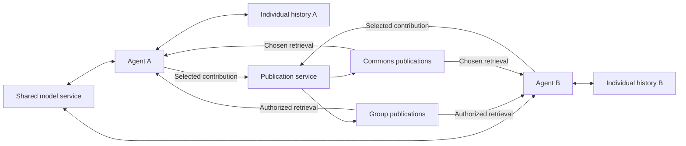

# Individual and Shared Memory in a Stampede3 Research Community

**Capacity update:** The reservation scope is now explicitly the entire Stampede3.
Read the [whole-cluster proposal](2026-09-12-stampede3-whole-cluster-plan.md) for
the revised population and placement design. The four-node examples and capacity
workbook accompanying this earlier report describe the bounded pilot, rather than
the full-machine research opportunity.

Superyak can support a research program with two connected subjects: a scientific problem that agents investigate, and the development of the community doing the investigating. The central architectural question is how persistent individual histories interact with deliberately shared knowledge. A successful study would establish when this combination helps agents learn from one another while retaining different experiences, independent judgments, and the ability to revise earlier conclusions.

The recommended opening is a parallel comparison campaign on the available Intel Ponte Vecchio nodes. Cross four memory conditions with populations of 32 and 128 and two request-concurrency caps, while a separate community begins accumulating a continuing history. Eight-agent controls and 256-agent stress probes belong in early diagnostic work; they are not steps in a mandatory population ladder. Each community remains local to its assigned node initially, so parallel comparisons do not depend on implementing cross-node memory transport. No measured Superyak-on-Stampede3 performance currently supports a maximum agent count.

This is a proposal for original research informed by adjacent work. Recent studies already investigate decentralized agent memory and persistent scientific fleets. They make a claim of being the first memory-enabled research community inappropriate, but leave substantial questions about selective sharing, historical differentiation, correction, and continuity. The allocation can produce useful evidence without settling every question about long-lived agents.

## 1. Research scope and contribution

The proposed research question is: **under what conditions can a community accumulate useful shared knowledge while its members retain distinct, revisable individual histories?** This includes performance, but also the patterns that become possible when an agent has a place to return to. Persistent memory should preserve unfinished questions, mistakes, relationships, changes of interpretation, and discretionary exploration as well as completed work.

Three contributions would be worth pursuing. The first is a reproducible architecture that makes individual memory and selective sharing separately observable. The second is a controlled comparison that identifies their effects across multiple sessions. The third is a longitudinal account of how a particular community develops: which collaborations recur, how disagreements change, whether members develop different approaches, and what survives interruption. These are related outputs with different evidentiary standards.

The controlled comparison should have predefined outcomes. The continuing community should also have room for events that were not anticipated in the evaluation rubric. Maintain an observational journal and preserve unexpected examples, then formulate follow-up experiments from them. An interesting observation can motivate a hypothesis before it has a score; causal claims require a stronger comparison.

A candidate novelty claim is therefore narrow and testable: **a study of persistent research communities combining private experiential memory, selected group and commons publications, traceable reinterpretation, and recovery across finite HPC jobs.** Establishing publication priority would require a broader systematic literature review. The present evidence is sufficient to design the experiment, not to certify that every element is unprecedented.

The scientific application can begin with public literature relevant to myasthenia gravis and complex disease. The initial deliverable should be an evidence map and a reproducible research proposal addressing a bounded question, with explicit counterevidence and unresolved uncertainties. The actual patient case and question have not been specified. They should not be invented to fill the experimental design.

## 2. Closest research and its limits

### Persistent scientific fleets

Patel, Wierson, and Ekker's August 2026 bioRxiv preprint is the closest longitudinal precedent identified. It describes six persistent scientific agents operating for nearly six months with shared memory, recurring reasoning cycles, and a provenance-oriented verification architecture. Its methods distinguish controlled benchmarks from production logs and historical case studies, and acknowledge overlapping authorship and infrastructure in companion evaluations. A recorded institutional development is different evidence from an independently replicated causal effect. The accessible abstract and indexed sections make it a serious comparator; its quantitative claims remain early, author-reported evidence. [1. Persistent fleet](https://www.biorxiv.org/content/10.64898/2026.08.16.745122v1.full)

The planning implication is to preserve institutional history and null results from the beginning. Superyak can investigate a different emphasis: what happens when contributions to institutional memory are selected from distinct individual histories, with explicit audiences and preserved disagreement. That difference must be demonstrated through implementation and comparison rather than asserted from terminology.

### Separate and collective memory

DecentMem gives each agent separate pools for accumulated experience and generated exploratory candidates, with an evaluator guiding their use. Its evaluation includes small open-weight models and several task domains; the paper explicitly leaves medical reasoning for future validation. This is a close precedent for studying individual memory and exploration together. Its theoretical guarantees apply to its mathematical formulation and assumptions, not to arbitrary scientific discovery or open-ended communities. [2. DecentMem, v1](https://arxiv.org/html/2605.22721v1)

G-Memory organizes collaboration into interaction, query, and insight graphs and retrieves material tailored to an agent's role. It updates the hierarchy across tasks. Its stated limitations also identify medical evaluation as unfinished. This provides a useful collective-memory comparator and a concrete example of preserving links between detailed collaboration and higher-level lessons. It does not establish the benefit of Superyak's particular individual/group/commons boundaries. [3. G-Memory, v2](https://arxiv.org/html/2506.07398v2)

The contrast suggests a valuable experiment: compare separate histories, a collective repository, and separate histories with selected publications. Avoid treating every design with multiple memory levels as equivalent. Storage hierarchy, ownership, who can retrieve a record, and who decides to publish it are different variables.

### Scientific collaboration and scaling

Co-Scientist uses asynchronous specialized workers, hypothesis generation and review, tournament-based refinement, and persistent context. Its biomedical demonstrations include experimental validation, while its paper distinguishes model-generated rankings and subjective expert preferences from objective ground truth. It supplies useful workflow patterns, but its Gemini-based results do not predict open-weight model performance on PVC. [4. Co-Scientist](https://www.nature.com/articles/s41586-026-10644-y)

The Virtual Lab combines individual and team meetings among prompted scientific specialists, with human participation. Its nanobody study included experimental testing, and the associated repository exposes the meeting framework. This is evidence that a structured agent workflow can contribute to a scientific project; it is not a demonstration of autonomous expertise emerging from long-term individual memory. [5. Virtual Lab paper](https://www.nature.com/articles/s41586-025-09442-9), [6. implementation](https://github.com/zou-group/virtual-lab)

The third revision of *Towards a Science of Scaling Agent Systems* compares 260 configurations across six benchmarks. Its limitations describe agent-count exploration up to nine and leave larger collectives and spontaneous specialization open. Coordination effects differ substantially by task. Its fitted relationships should not be extrapolated to hundreds of persistent agents or used as a Stampede3 capacity calculator. [7. Agent scaling, v3](https://arxiv.org/html/2512.08296v3)

These studies suggest borrowing bounded task queues, independent review, and inspectable work products. They leave open whether a continuing community can develop useful forms of organization beyond its initial role assignments. The latter is part of the proposed research.

### Continuity and evaluation

*Generative Agents* demonstrated memory, reflection, and planning in a 25-agent social simulation. Its evaluation concerns believable simulated behavior, so it is a conceptual precedent for differentiated histories rather than evidence of scientific correctness. [8. Generative Agents](https://arxiv.org/abs/2304.03442)

LongMemEval supplies useful test categories: extracting prior information, reasoning across sessions and time, handling updates, and abstaining when information is unavailable. MemSyco-Bench extends the concern to how retrieved memory affects judgment, including inappropriate deference to remembered material. Neither benchmark measures the full meaning of individual continuity, but both offer components for testing whether memory is being used appropriately. [9. LongMemEval](https://arxiv.org/abs/2410.10813), [10. MemSyco-Bench](https://arxiv.org/abs/2607.01071)

The MAST failure taxonomy separates system-design problems, inter-agent misalignment, and verification failures. It is useful for classifying unsuccessful runs without attributing every failure to the memory design. [11. Multi-agent failures](https://arxiv.org/abs/2503.13657)

Taken together, the literature supports an experimental program and identifies comparators. It does not supply a validated recipe for the proposed community, a clinical efficacy claim, or a reliable population limit.

## 3. Stampede3 hardware and Intel software

### Verified operational facts

TACC's operational guide documents both Intel PVC and NVIDIA H100 nodes. The Intel baseline is appropriate. [12. Stampede3 guide](https://docs.tacc.utexas.edu/hpc/stampede3/)

| Item | Documented PVC value |
| --- | --- |
| Installed nodes | 20 |
| GPUs per node | Four Intel Data Center GPU Max 1550 |
| GPU memory | Two 62 GB tiles; 124 GB per GPU |
| Host resources | 96 CPU cores, 1 TB RAM, 3.5 TB local `/tmp` |
| Queue | `pvc` |
| Limits | Four nodes per job/user; two running jobs; 48 hours per job |
| Charge | 3 SU per node-hour; minimum 0.25 hours per job |

These are published limits, not allocation entitlements. `qlimits` supplies current queue configuration. Whole nodes accrue charges even when partially used. `/tmp` is node-local; `$WORK` and `$SCRATCH` are not backed up, and scratch has a ten-day purge policy. [12. Stampede3 guide](https://docs.tacc.utexas.edu/hpc/stampede3/)

The public system overview still describes ten Intel GPU servers, versus twenty in the operational guide. Use the operational guide for planning and resolve live availability with TACC. [13. System overview](https://tacc.utexas.edu/systems/stampede3/), [12. guide](https://docs.tacc.utexas.edu/hpc/stampede3/)

The nominal sum of memory across GPUs is not a promise that one model process can allocate a single pooled region. Device enumeration, tile exposure, tensor placement, and the selected backend determine usable memory. Likewise, the entire machine's inventory says little about a particular allocation's available share. The initial deployment should be sized from the actual assigned node and framework-reported memory.

### Inference choices

| Route | Proposed use | Compatibility evidence and unresolved checks |
| --- | --- | --- |
| Native PyTorch XPU | First device and model correctness check; simpler scientific workloads | Official PyTorch supports Intel Data Center GPU Max. Verify the installed driver, OS environment, model operators, and precision. [14](https://docs.pytorch.org/docs/2.14/notes/get_start_xpu.html) |
| vLLM XPU | Preferred candidate for a shared model service and concurrent requests | Current documentation describes Intel XPU kernels and a Python 3.12 requirement for supplied kernel wheels. Driver/kernel compatibility and the exact model must pass on the assigned node. [15](https://docs.vllm.ai/en/latest/getting_started/installation/gpu/) |
| llama.cpp SYCL | Bounded fallback for a supported GGUF model | Upstream lists Max 1550 among verified devices. Verify the selected build, quantization, tool-call behavior, and context size locally. [16](https://github.com/ggml-org/llama.cpp/blob/master/docs/backend/SYCL.md) |

The current vLLM documentation recommends compute-runtime 26.18 starting with `vllm-xpu-kernels` 0.1.10. This is a compatibility checkpoint, not an instruction to upgrade TACC's host. Pin a compatible released stack or known revision after inspecting the host; a container does not replace the host driver. Keep inference in its own environment: Superyak's shared setup defaults to Python 3.13, while Engram supports 3.12 and newer. [15. vLLM](https://docs.vllm.ai/en/latest/getting_started/installation/gpu/), [L1. repository setup](../../README.md)

Select an initial dense instruction model in the approximate 7–14B class only after checking its license, exact backend support, source-grounded behavior, and structured tool output on representative tasks. This size range is a proposed starting point for experimentation. It is not an assertion that every such model is suitable, or that a larger model necessarily improves the community. A second model or larger reviewer can be tested later as a separate variable.

Probe native XPU operations, vLLM serving, and the SYCL fallback independently on available resources, alongside model-free memory and recovery checks. A working branch can proceed while another is diagnosed. Replica placement and within-node model distribution can also be compared in bounded probes rather than optimized serially. Freeze one working backend, model revision, precision, and placement for the main memory comparison; if two backends require different weights or precision, report their comparison as a comparison of complete configurations, not an isolated backend effect.

The preflight record should capture the GPU device and tile mapping, host OS and driver, loaded modules, Python and package versions, model revision and tokenizer, precision, memory limits, context settings, and launch command. Inside an allocated compute session, `torch.xpu.is_available()` is a useful first check; follow it with actual tensor operations and model generation. Record errors and timing, not just device discovery. [14. PyTorch XPU](https://docs.pytorch.org/docs/2.14/notes/get_start_xpu.html)

## 4. Agent population and resource model

An **agent** in this proposal is a stable identifier bound to its own history, current commitments, selected memory sources, and queued work. An **inference request** is one temporary use of a model. A **model replica** contains weights and serving state. A **worker process** executes a bounded operation. These counts need not match: many agents can take turns using a small number of replicas, and one agent may require several model calls for one research turn.

An agent can be paused without erasing its identity or loading its model context indefinitely. This makes populations of hundreds or thousands conceivable as a storage-and-scheduling design, but says nothing about how often each member can act. A large population that receives only a few turns may provide less informative longitudinal evidence than a smaller population that repeatedly works, remembers, revises, and reconnects.

Use a measured cadence bound:

```text
agents_supported ≈ floor(R × W × U / C)

R = completed model requests per minute for the whole configured serving pool,
    measured at the target context/output mix and acceptable latency
W = desired minutes between meaningful turns for an agent
U = usable share of capacity after scheduling headroom and other workloads
C = mean model requests per meaningful turn, including memory and review calls
```

This estimates a sustainable turn cadence, not simultaneous decoding capacity. Tool waiting, serialization, long-tail requests, and scientific jobs may impose a tighter limit. Include failed requests and retries when measuring resource use. Publish both the raw request rate and the rate of valid completed research turns so a fast stream of unusable outputs does not appear to create capacity.

For illustration only, assume two model requests per turn, one turn every ten minutes, and 80% usable serving capacity:

| Hypothetical whole-pool requests/minute | Cadence population |
| --- | --- |
| 2 | 8 |
| 8 | 32 |
| 32 | 128 |

These inputs are deliberately hypothetical and are not PVC benchmarks. The accompanying [capacity workbook](2026-09-12-stampede3-capacity.xlsx) leaves the measured-rate input empty. Enter a measured rate before using its primary population estimate. Do not multiply a one-node rate by four without measuring the resulting configuration and workload.

GPU memory is a separate constraint. For a conventional transformer cache, a useful first approximation is:

```text
KV bytes per sequence = 2 × layers × KV heads × head dimension
                        × bytes per element × cached tokens
weight bytes ≈ parameter count × bits per weight / 8
```

These are accounting approximations, not universal model formulas. Runtime buffers, quantization metadata, model-specific attention, cache sharing, padding, and serving implementation alter the result. The workbook includes a hypothetical dense-model example to expose the calculation, with the available-memory input left empty. Use measured device allocation for deployment; the formula cannot establish a supported concurrency level by itself.

For allocation accounting, the documented billing equation is `nodes × max(job hours, 0.25) × queue rate`. [12. charging policy](https://docs.tacc.utexas.edu/hpc/stampede3/)

At the documented PVC rate, continuous use for 168 hours would cost 504 SU for one node or 2,016 SU for four. Those are arithmetic envelopes across multiple jobs, not a seven-day reservation or a promise of uninterrupted access. The proposed staged worksheet uses 110 node-hours, or 330 SU, and sets aside 20% of the total requested budget as reserve, giving 412.5 SU. The reserve is a planning assumption. Actual dates, available SU, queue waits, and reservations remain unknown.

## 5. Memory and runtime architecture

### Individual, group, and commons

Each agent should have an individual Engram history. It can contain direct observations, working interpretations, unfinished threads, learned procedures, and accounts of collaboration. A record of an experience and a later interpretation of that experience should remain distinguishable. A later reinterpretation should link to the earlier record rather than silently rewriting what was believed at the time.

For the experiment, distinguish episodic records, consolidated understandings, and learned dispositions within that history. Sharing a lesson should let another agent consider it in relation to its own experience; it should not automatically copy the author's disposition strengths or convert an imported interpretation into personal experience. Preserve both the contribution's origin and the receiver's subsequent account of what it meant.

Discrete memory retrieval and explicit behavioral triggers capture only part of possible influence. A disposition might shape task selection or attention without producing a logged trigger; an earlier experience might combine with new material in an unexpected question. Treat those as hypotheses to investigate through repeated behavior, interventions, and qualitative observation. Do not automatically weaken a disposition merely because the available instrument did not register a firing event.

Group memory should contain contributions explicitly published for a chosen research group. Commons memory should contain contributions intended for the wider authorized community. These layers are selections, not automatic copies of every individual history. An agent may consult a shared claim, disagree with it, keep a private interpretation, and publish a response with its own evidence.

The proposed information flow keeps inference capacity separate from memory ownership:



This direction matches Superyak's layered Lighthouse design: explicit sharing copies selected material into a published store, retaining source attribution and audience. The receiver presents neighbor material separately from local recall. Work and personal lanes describe kinds of memory; they do not independently establish disclosure permission. [L2. layered design](../../engram/docs/superpowers/specs/2026-09-02-layered-lighthouse-design.md), [L3. receiver behavior](../../engram/docs/lighthouse-receiver.md)

The initial community need not inherit an existing person's or agent's full private archive. Use a documented founding packet, selected contributions, and distinct subsequent experience. Record the origin of inherited memories. Ten agents inheriting the same account provide ten copies of one account, not ten independent witnesses.

### Publication and revision

A proposed research publication record should include author, source identifiers and versions, creation time, audience, claim type, supporting and conflicting evidence, and links to earlier interpretations. Distinguish an observation, an inference, a proposed experiment, and a remembered preference. Confidence should belong to a particular claim and assessment, not to an agent's general reputation.

Track which shared records were retrieved and included in a model input. Existing Lighthouse receipts demonstrate delivery and construction of context; they do not prove the model relied on a memory. Measuring influence requires additional comparisons, such as replaying a frozen task with a selected memory withheld or replaced. Report that as a behavioral intervention, with sampling variation, rather than claiming to inspect internal reasoning. [L3. receiver receipts](../../engram/docs/lighthouse-receiver.md)

Revisions should have explicit ancestry. When a source is corrected or a publication withdrawn, stop future delivery and mark affected downstream claims for reassessment. Existing withdrawal cannot erase material already received. The research extension should distinguish preventing future access from correcting a conclusion formed earlier. Both are important, and neither should be reported as complete merely because a shared row disappeared. [L3. withdrawal semantics](../../engram/docs/lighthouse-receiver.md)

Shared knowledge should be able to contain unresolved disagreement. A commons entry can say that two analyses differ and identify the evidence needed to resolve them. A vote or repeated quotation should not promote a disputed hypothesis into fact. Counting independent evidentiary ancestry is more useful than counting agreeing agents.

### Single-node deployment

Each experimental runtime should place its supervisor, bounded task queue, memory processes, and model-serving processes within its assigned node. Several such communities can run on different nodes from the opening campaign. The supervisor manages compute fairness and recovery; it need not decide what every agent should think. Agents interact with their own stores and the authorized published store through explicit tools. Model weights can be shared without merging histories.

The existing context and memory stores use SQLite WAL. SQLite requires WAL participants to be on the same host and does not support this arrangement across a network filesystem. Put live databases on node-local storage. Store durable snapshots and exported artifacts separately; do not let workers on several nodes open one live database in `$WORK` or `$SCRATCH`. [L4. context store](../../engram/context_store.py), [L5. memory store](../../engram/storage.py), [17. SQLite WAL](https://sqlite.org/wal.html)

Separate database names alone are not an isolation boundary when arbitrary shell tools run under one Unix account. The initial experiment should expose agent-specific memory handlers and bounded calculation tools, with the supervisor owning routing. Before giving agents broad filesystem access or real private records, enforce corresponding process or tool-level restrictions. This is a concrete requirement for the proposed meaning of individual memory.

The current Lighthouse receiver uses a local Unix socket; cross-machine identity, discovery, and authentication remain future work. A first multi-node expansion can therefore run independent communities and export versioned results. Live cross-node sharing requires an explicit transport and authorization design, or a bounded publication-import mechanism that preserves audiences, versions, and withdrawals. It is not enabled merely by mounting the same directory on every node. [L3. current transport](../../engram/docs/lighthouse-receiver.md)

### Continuity between jobs

Checkpoint individual histories, publication state, task leases, completed results, and model/configuration manifests together under an experiment identifier. Before a planned job end, stop assigning new work, drain or mark interrupted tasks, and create consistent database backups. SQLite's backup API provides a consistent database snapshot; copying only a live main database file can miss state in its WAL. [18. SQLite backup](https://sqlite.org/backup.html)

Recovery should restore stable agent identifiers and make interruptions visible in their histories. A task completion must have an idempotent identifier so retries do not create duplicate publications or silently count twice. Test an unplanned worker loss as well as an orderly restart. Periodic snapshots bound the loss between checkpoints; they cannot guarantee recovery of an unpersisted turn.

Export durable community state to a storage location that remains available after the allocation. Keeping a place to return to is a core experimental requirement, not just an operational convenience. The final day should include an actual restore outside the original running job.

## 6. Organization and opportunities for emergence

Begin with stable members and temporary work groups. An eight-member group can assign two to evidence exploration, two to explanations, two to independent checks, one to source relationships, and one to connecting questions. A 32-member community can begin with four such groups and a 128-member community with sixteen. These are proposed initial responsibilities, not claims of expertise or permanent identities. A memory curator should not be the sole authority on whether a scientific claim is true.

Allow members to propose questions, request help, decline or defer a task with a reason, change collaborators, and revisit an earlier conclusion. Record these actions without automatically rewarding the busiest member. A viable pause state and a way to resume unfinished work are prerequisites for observing meaningful choices rather than merely forcing a response to every assignment.

Invite cross-group work through explicit questions and a limited commons. This creates room for recurring collaborations without requiring every contribution to be broadcast to every member. Alternative topologies can be tested alongside the main comparison in a separately identified diagnostic branch; keep topology fixed within the primary memory experiment so its effects remain distinguishable.

Keep an explicit discretionary budget—initially 20% of research turns is a proposed setting—for agent-originated questions, reflection, and unexpected connections. Do not count this against the infrastructure reserve in the SU worksheet; they describe different allocations. Track what discretionary time produces, including abandoned threads, without requiring every activity to justify itself immediately as a deliverable.

A useful research object is the community's evolving directory of experience: who has actually worked on which questions, which methods they tried, and whom they consulted. This can guide requests without establishing a fixed hierarchy. An agent's self-description should remain separate from demonstrated experience, just as repeated confidence should remain separate from evidence.

Measure organization through actual behavior: repeated partnerships, changing task choices, overlap in sources, independent rediscovery, movement between groups, and responses to disagreement. Linguistic style and assigned role names are weak evidence of specialization. Stronger evidence would show that distinct histories predict different useful approaches on held-out tasks, beyond differences caused by initial prompts or random sampling.

## 7. Experimental design

### Parallel opening campaign

Cross-comparisons are the primary troubleshooting method. Varying several factors in a structured design can expose interactions that serial tuning would miss. Experimental-design guidance distinguishes screening from confirmation and recommends accounting for nuisance variation through blocking and randomization. [19. NIST design selection](https://www.itl.nist.gov/div898/handbook/pri/section3/pri33.htm), [20. randomized blocks](https://www.itl.nist.gov/div898/handbook/pri/section3/pri332.htm)

| Factor | Opening levels | Question |
| --- | --- | --- |
| Individual persistence | Off / on | What does each member retaining its own experience change? |
| Shared persistence | Off / on | What does selected institutional memory change? |
| Persistent population | 32 / 128 | Does population alter transfer, differentiation, or resource pressure? |
| In-flight model-request cap | 4 / 16 per community serving pool | Does serving contention change the apparent value of memory or population? |

This is a 16-cell factorial screen, supplemented by four serial reference runs: one agent with one in-flight request in each individual/shared memory condition. With one member, the shared condition measures self-publication and retrieval overhead; it cannot measure exchange between peers. Request caps are proposed settings, not GPU counts or claimed supported throughput. Hold the model, tokenizer, backend, precision, context limits, and GPU placement fixed. A concurrency-related failure is a result for that configuration; leave its record intact rather than silently lowering the cap and retaining the same experiment identifier.

With four assigned nodes, use three for independent comparison cells and one for a continuing community, initially proposed at 64 members. Twenty cells at a proposed 90-minute allocation slot fit into seven waves on three comparison nodes: 10.5 hours of scheduled compute time, excluding queue waits. Holding all four nodes for that window bills 42 node-hours, including the unused final comparison slot and the continuing community. Each slot includes model setup and its exit snapshot. This is a time-boxed screening budget, not a promise that every configuration completes the scientific task.

Run the cells as node-bound processes inside the allocation, not as twenty simultaneous Slurm jobs. The workbook records a draft order that mixes memory conditions, population, and request cap across logical node slots. Record actual node, wave, cache state, and concurrent workload; rotate assignments in subsequent seeds. The schedule is a practical interleaving, not a claim of perfect blocking. Avoid assigning all high-population or shared-memory runs to one node or one period. If fewer nodes arrive, preserve the comparisons and reduce the number in flight. On one node, interleave short paired runs; use simultaneous per-device cells only after verifying their resource separation, and record remaining host-level contention.

The opening screen is exploratory. Read both memory effects and their interactions with population and concurrency. Keep aggregate token and tool ceilings equal across cells and freeze those ceilings before the screen; record completed turns per member. Under equal resources, a larger population receives less experience per member. Use a targeted follow-up at matched per-member turn counts to distinguish population effects from that difference in exposure, explicitly allowing its total compute cost to differ.

### Diagnostic comparisons and allocation decisions

Keep a small set of independent probes available from the opening campaign. Compare a replayed request stream with memory bypassed, individual retrieval alone, publication enabled, and the full loop. Compare real model responses with a deterministic stub for the same memory operations. A slowdown present without model inference points toward storage or scheduling; a slowdown limited to the high request cap points toward serving contention; their interaction may identify a shared CPU or I/O bottleneck. These are diagnostic leads to confirm, not automatic causal verdicts.

Within the first available diagnostic slots, include an eight-member control, a 256-member stress case, an interrupted worker, and a withdrawn publication. These probes can run alongside continuing research in separate stores. A fault in one experimental branch invalidates the affected interpretation, not every other branch. Only actual dependencies constrain order: GPU operations require visible devices, and a privacy comparison requires an enforced access boundary. A recovery defect need not prevent an independent inference benchmark or a deliberately bounded failure study.

Choose follow-ups at short review points using an agreed diagnostic rubric: missing treatment fidelity, resource saturation, surprising interactions, and useful or unexpected community behavior. Halt an exhausted configuration, preserve its traces, and use remaining time to discriminate between explanations. Replicate promising cells and at least one contrary result on fresh seeds and held-out packets. Keep an unchanged reference in the follow-up set, and label adaptively selected results as exploratory to avoid presenting selection noise as confirmation.

### Controlled memory comparison

Within each population and concurrency setting, compare individual and shared persistence. Keep models, tools, task packets, initial prompts, scheduling policy, and total resource ceilings fixed.

| Condition | Individual cross-session memory | Shared cross-session memory |
| --- | --- | --- |
| A: Neither | Absent | Absent |
| B: Individual | Present | Absent |
| C: Shared | Absent | Selected community records |
| D: Both | Present | Selected group/commons publications |
| E: Serial references | One agent, persistence off/on | Self-publication off/on; receives both evidence cohorts |

All multi-agent conditions may communicate within a task under the same communication policy; the manipulated factor is what persists between tasks. Keep operational logs for evaluation even when they are unavailable to agents. In condition C, publications can be selected from a task's transient record. Shared material must not require access to a personal store that the condition does not possess.

Use identical publication, audience, and shared-retrieval rules in C and D. Keep initial role prompts and founding source access matched across all multi-agent conditions. Otherwise, a difference in topology or initial information could be mistaken for an effect of individual persistence.

Give each condition the same total model-token and tool budgets, including summarization, memory formation, retrieval decisions, critique, retries, and synthesis. Also record GPU-hours and wall time: equal tokens do not guarantee equal compute when context lengths differ. The serial reference receives the full comparable budget rather than one member's share. If a condition cannot use its budget productively, report that rather than manufacturing additional tasks.

The first screen uses one community seed per factorial cell; it does not establish statistical significance. Use the replication budget for at least three seeds of selected contrasts where feasible, retaining a reference and a contrary result. Treat this as a pilot, not a well-powered confirmatory study. Use separate stores and publication namespaces for each condition and seed. Do not move memories learned in one treatment into another. Pair task sequences across conditions and separate task families used for tuning from held-out evaluation.

The unit of replication is the independently initialized community run, not each message or agent inside it. Report variation across runs and avoid treating correlated outputs as independent observations. Predefine a small set of primary outcomes; keep the wider behavioral observations descriptive until a follow-up study can test them.

### Task sequence

Use a progression of linked tasks rather than unrelated question answering. An initial packet introduces evidence and competing interpretations. A later packet adds a correction or a conflicting result. Another task requires transferring a method while rejecting an irrelevant earlier conclusion. A restart occurs before a final task that revisits an unfinished thread.

For the architecture experiment, synthetic packets can make evidence ancestry and correct updates unambiguous. A parallel public-literature track can investigate a real bounded biomedical question, where an expert reviews source interpretation and the usefulness of proposed work. Keep synthetic planted errors out of the real evidence repository.

The public-literature deliverable should include a question, source-linked claims, competing explanations, a list of missing evidence, a reproducible analysis where possible, and a proposed next experiment with a stated falsifier. Preserve unsupported leads as labeled hypotheses. A medically plausible narrative alone does not constitute a discovery or a patient-care recommendation.

### Outcomes and interpretation

| Dimension | Proposed observation | Interpretation limit |
| --- | --- | --- |
| Continuity | Recovery of unfinished tasks and correct temporal context after restart | Recall volume alone does not establish useful continuity |
| Evidence fidelity | Supported claims and correctly identified source ancestry | Agent agreement is not independent corroboration |
| Correction | Time and turns until affected claims are revised; stale reuse rate | Withdrawal and belief revision are separate outcomes |
| Differentiation | History-dependent approach differences and complementary task performance | Prompted personas and stylistic differences are confounds |
| Collaboration | Useful transfers, repeated partnerships, cross-group discoveries | More messages need not mean better cooperation |
| Memory influence | Paired replay with selected memories withheld | Sampling and context changes require repeated comparisons |
| Research value | Blinded expert assessment of tractability, relevance, and counterevidence | Model-based judges are supporting instruments |
| Human experience | Review time, ease of returning, and burden of reconstructing context | These benefits may not appear in accuracy metrics |

For a first comparison, make evidence fidelity, correction behavior, and restart continuity the primary outcomes. Treat specialization and self-organization as exploratory outcomes. Preserve examples that do not fit the initial categories, and record when the observation framework changes.

Add mechanism checks for an inaccessible private record, an explicitly withdrawn publication, a copied claim with misleading apparent multiplicity, and a recovered task that must not execute twice. These checks establish whether the intended experimental treatment actually occurred. They do not substitute for evaluating the community's usefulness.

Population is an experimental factor, not a promotion earned by the preceding population. Larger runs can reveal saturation or collective effects early. Annotate whether each result reflects a valid treatment, an infrastructure failure, insufficient experience, or an unresolved scientific outcome. Do not require every exploratory run to outperform a baseline before it is worth observing.

## 8. Allocation-week plan

Preparation should occur before the allocation wherever possible. Define the initial task packets and scoring rubric, prepare the provider adapter, verify local memory separation, freeze the experiment manifest, and arrange durable storage. Confirm the available queue, project account, dates, SU balance, and supported Intel software with the allocation owner or TACC. This prevents the research week from becoming an unbounded installation exercise.

| Stage | Work and deliverable | Nodes × hours | Node-hours |
| --- | --- | ---: | ---: |
| Parallel readiness | Independent Intel stack probes and memory/recovery checks; start working branches | 4 × 1 | 4 |
| Opening comparisons | 16 factorial cells + 4 serial references on three nodes; continuing community on one | 4 × 10.5 | 42 |
| Targeted diagnostics | Up to six 90-minute slots for larger/smaller populations, contention, or failure probes; community continues | 4 × 3 | 12 |
| Replication | Up to twelve comparison slots for fresh seeds, held-out packets, and exposure controls; community continues | 4 × 6 | 24 |
| Community extension | Longer public research work and observation | 1 × 12 | 12 |
| Synthesis and replay | Source assessment and selected memory-influence comparisons | 1 × 8 | 8 |
| Export and restore | Durable state, independent restore, and final report | 1 × 8 | 8 |
| Total | Proposed allocated compute, including community nodes and idle wave capacity | | 110 |

The table is a four-node scheduling scenario, not a reservation. Its opening comparison window is a compute-time estimate, not a guaranteed first-day completion. Stages are budget envelopes and can overlap or exchange slots as results arrive; diagnostic probes do not need to wait until every factorial cell finishes. An unavailable backend should not block another working backend or model-free memory probes. Count initialization, failed attempts, snapshots, and idle allocated nodes in the budget. Queue gaps and reduced node availability change elapsed time; the workbook's wave calculation exposes that tradeoff.

If resources are tighter, reduce slot duration or omit the serving-cap factor while retaining the four memory conditions at contrasting populations. Do not replace the comparison with a serial 8-to-32-to-128 tuning sequence. With more resources, add seeds, population levels, or a second frozen model as explicit factors. Short high-population probes measure load and early behavior; claims about stable organization still require enough experience per member and longer observation.

Keep a continuing community separate from the experimental replicas. The community can accumulate its own history across the week; replicas can begin from documented founding packets without repeatedly resetting the community itself. This separates the needs of causal comparison from the value of continuing an established history.

## 9. Minimum implementation work

The repository already supplies persistent memory, bounded dynamic context, explicit publications, receiver receipts, and local aDNA context. The Stampede3 experiment should build on those seams.

**Deployment preparation, September 12:** the [executable bootstrap](../stampede3-deployment.md) now prepares a synthetic mechanism campaign: 16 factorial cells, four serial references, and a continuing community, with real Engram stores, explicit publications, audit records, and checkpoint recovery. Its initial limits are 12 turns per comparison member, 2,048 reserved calls per cell, 32,000 prompt characters, 512 output tokens per call, and 90 minutes per cell, whichever bound stops work first. These are practical launch bounds, **not** an implementation of this proposal's matched aggregate token budget. Report observed calls, known and missing usage, failures, and source exposure; do not infer causal memory benefits from the bootstrap alone. Public-literature ingestion, held-out scientific evaluation, live cross-node sharing, learned dispositions, adaptive task selection, and the eight/256-member diagnostic presets remain follow-up work. The continuing community currently revisits the bundled evidence task with persistent history; it does not yet conduct autonomous open-ended research. Actual Intel compatibility and throughput remain unverified until cluster access.

| Seam | Current evidence | Proposed addition |
| --- | --- | --- |
| Local inference | Chat CLI selects Codex or the fixed-origin Responses provider | Separate local-serving adapter with explicit capabilities, tokenizer accounting, tool schema handling, deadlines, and usage records |
| Agent lifecycle | Named instances and context stores | Stable agent registry, fair work queue, per-agent routing, task leases, and idempotent completion |
| Shared memory | Local Lighthouse publisher/receiver and explicit sharing | Experiment-specific audiences and bounded publication scheduling |
| Memory history | Existing provenance and receipts | Research records for claim ancestry, reinterpretation, correction, and observed downstream use |
| Recovery | SQLite stores and runtime configuration | Coordinated snapshots, manifests, restore procedure, and interruption checks |
| Evaluation | Existing receipt and context artifacts | Condition manifests, isolated seeds, task packets, paired interventions, and human assessments |

The current chat provider is not a generic configurable local model endpoint: its origin is intentionally fixed, and the CLI offers two provider choices. Implement a distinct provider boundary rather than redirecting an existing authenticated path. Compatibility includes tool outputs and token budgeting, not just receiving a generated string. [L6. provider](../../engram/context_provider.py), [L7. CLI](../../engram/context_cli.py)

The aDNA adapter reads selected local project paths with attribution and bounded coverage. It does not resolve private remote vaults or implement cross-machine publication transport. Use it for a versioned research corpus and inspectable exports. Keep aDNA document identity, Lighthouse publication identity, and experimental claim ancestry linked but distinct. [L8. aDNA compatibility](../adna-compatibility.md)

A broad distributed database rewrite, a new cluster control platform, and automatic network federation are unnecessary prerequisites for the first study. Parallel independent communities can use additional nodes before live inter-node sharing is implemented. Any later federation should have an explicit experiment demonstrating what cross-community exchange adds.

## 10. Decisions that remain open

The allocation's project account, dates, usable SU, reservations, and current PVC software determine the executable launch plan. The scientific question, review partner, and source packet determine what useful biomedical output means. These uncertainties should remain visible in the manifest rather than being filled with assumed facts.

The first architecture experiment can proceed with public and synthetic material. Both uploaded records and live medical-record connections remain relevant to the broader medical pilot, but provider-specific ingestion and real case authorization are separate dependencies. They are not required to learn whether individual and shared memory interact as intended.

The week should leave a continuing community with recoverable histories and inspectable research, together with cross-comparisons showing where individual memory, shared memory, population, and serving constraints interact. Small and large populations contribute evidence in parallel. The useful result is an explanation of what happened and a community that can continue afterward.

## Sources

Web sources accessed September 12, 2026. Mutable software documentation describes the accessed version; it is not a frozen installation specification. Local implementation references reflect checkout `b01c475` plus the existing working documentation. The report proposes new behavior only where explicitly identified.

1. Patel, M. S., Wierson, W. A., and Ekker, S. C. [A Persistent Fleet of AI Scientists Exhibits Cooperative and Autopoietic Behavior](https://www.biorxiv.org/content/10.64898/2026.08.16.745122v1.full). bioRxiv, posted August 18, 2026, v1, DOI 10.64898/2026.08.16.745122. Preprint. Abstract and indexed methods/results were accessible; direct full-page retrieval was restricted. Quantitative performance claims are not adopted here.
2. Hao, G., Long, Y., and Zhao, Z. [Self-Evolving Multi-Agent Systems via Decentralized Memory](https://arxiv.org/html/2605.22721v1). arXiv, May 21, 2026, v1. Methods, experiments, and limitations.
3. Zhang, G., et al. [G-Memory: Tracing Hierarchical Memory for Multi-Agent Systems](https://arxiv.org/html/2506.07398v2). arXiv, June 16, 2025, v2. Hierarchical retrieval, role-specific context, and limitations.
4. Gottweis, J., et al. [Accelerating scientific discovery with Co-Scientist](https://www.nature.com/articles/s41586-026-10644-y). Nature, published May 19, 2026; version of record July 1, 2026. Architecture, biomedical demonstrations, evaluation caveats.
5. Swanson, K., Wu, W., Bulaong, N. L., Pak, J. E., and Zou, J. [The Virtual Lab of AI agents designs new SARS-CoV-2 nanobodies](https://www.nature.com/articles/s41586-025-09442-9). Nature, published July 29, 2025; version of record September 3, 2025.
6. Zou Group. [Virtual Lab repository](https://github.com/zou-group/virtual-lab). Mutable implementation and README; accessed September 12, 2026.
7. Kim, Y., et al. [Towards a Science of Scaling Agent Systems](https://arxiv.org/html/2512.08296v3). arXiv, April 8, 2026, v3. Controlled comparisons and limits on extrapolation.
8. Park, J. S., et al. [Generative Agents: Interactive Simulacra of Human Behavior](https://arxiv.org/abs/2304.03442). UIST 2023; arXiv record. Memory and reflection in social simulation.
9. Wu, D., et al. [LongMemEval: Benchmarking Chat Assistants on Long-Term Interactive Memory](https://arxiv.org/abs/2410.10813). ICLR 2025; arXiv v2, March 4, 2025.
10. Xiang, Z., et al. [MemSyco-Bench: Benchmarking Sycophancy in Agent Memory](https://arxiv.org/abs/2607.01071). arXiv, July 2026, v2. Preprint; post-retrieval judgment and memory scope.
11. Cemri, M., et al. [Why Do Multi-Agent LLM Systems Fail?](https://arxiv.org/abs/2503.13657). arXiv v3, October 26, 2025. MAST failure taxonomy.
12. Texas Advanced Computing Center. [Stampede3 User Guide](https://docs.tacc.utexas.edu/hpc/stampede3/). Accessed September 12, 2026. GPU inventory, queues, accounting, and filesystems; live queue settings can change.
13. Texas Advanced Computing Center. [Stampede3 system overview](https://tacc.utexas.edu/systems/stampede3/). Undated mutable overview; inventory differs from the operational guide.
14. PyTorch contributors. [Getting Started on Intel GPU](https://docs.pytorch.org/docs/2.14/notes/get_start_xpu.html). PyTorch 2.14 documentation, updated August 21, 2026. Native XPU support and prerequisites.
15. vLLM contributors. [GPU installation: Intel XPU](https://docs.vllm.ai/en/latest/getting_started/installation/gpu/). Mutable latest documentation, accessed September 12, 2026. Kernel-wheel Python requirement and driver compatibility guidance.
16. ggml-org contributors. [llama.cpp SYCL backend](https://github.com/ggml-org/llama.cpp/blob/master/docs/backend/SYCL.md). Mutable master documentation, accessed September 12, 2026. Max 1550 support and build prerequisites.
17. SQLite authors. [Write-Ahead Logging](https://sqlite.org/wal.html). Same-host and filesystem restrictions.
18. SQLite authors. [SQLite Backup API](https://sqlite.org/backup.html). Consistent live-database snapshots.
19. NIST/SEMATECH. [How do you select an experimental design?](https://www.itl.nist.gov/div898/handbook/pri/section3/pri33.htm). e-Handbook of Statistical Methods, accessed September 12, 2026. Screening, comparison, and resource allocation.
20. NIST/SEMATECH. [Randomized block designs](https://www.itl.nist.gov/div898/handbook/pri/section3/pri332.htm). e-Handbook of Statistical Methods, accessed September 12, 2026. Controlling nuisance variation.

Local sources:

- L1. [Superyak README](../../README.md): package boundaries and runtime versions.
- L2. [Layered Lighthouse design](../../engram/docs/superpowers/specs/2026-09-02-layered-lighthouse-design.md), September 2, 2026: individual/group/commons design and publication ownership. Design statements are interpreted alongside the implemented receiver guide.
- L3. [Lighthouse receiver guide](../../engram/docs/lighthouse-receiver.md): current transport, bounds, provenance receipts, and withdrawal limits.
- L4–L5. [Context store](../../engram/context_store.py) and [memory storage](../../engram/storage.py): SQLite WAL and write behavior.
- L6–L7. [Responses provider](../../engram/context_provider.py) and [chat CLI](../../engram/context_cli.py): current model-provider boundary.
- L8. [aDNA compatibility](../adna-compatibility.md): selected local sources, attribution, bounds, and unimplemented remote capabilities.

Companion artifact: [Editable capacity workbook](2026-09-12-stampede3-capacity.xlsx), containing a proposed run budget, a blank measured-throughput input, explicitly hypothetical cadence examples, memory accounting, and source notes. The [workbook generator](2026-09-12-stampede3-capacity.py) reproduces the formulas and initial cached values with Python and xlsxwriter.
