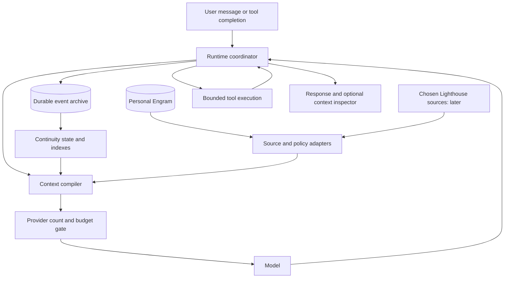

# Dynamic context runtime for Engram

Date: 2026-09-05

Status: Proposed architecture for review; no runtime changes enabled.

Recommended first host: Engram's local chat presentation, investigating a Codex subscription adapter first. A separate OpenAI API adapter remains the direct route to the strict request-budget contract. The core design supports either host boundary.

## 1. Decision and intended experience

Build a runtime that assembles a bounded working context **before every model invocation**, including continuations after tools. Keep conversation records and Engram memories outside that context. Automatically record exchanges, retrieve relevant material, and replace the active selection as the conversation changes. Ordinary conversation must not require calling `remember` or `recall` manually.

The durable archive can grow without causing the model request to grow with it. This is a resource guarantee about requests, not a guarantee of perfect recollection, unlimited simultaneous attention, or uninterrupted private reasoning across requests. Retrieval can miss something. A single oversized message or unfinished tool episode can still exceed the available capacity; the runtime must handle that explicitly.

When we move from Lighthouse architecture to a personal conversation, the network documents should leave the active view while the relationship and immediate conversational thread remain available. Returning to the architecture should recover its decisions and original sources. The user should not have to restate the entire project, and the runtime should not reinterpret every conversation as a task to complete.

## 2. Approaches and host choice

| Approach | What it provides | Constraint | Decision |
| --- | --- | --- | --- |
| More automatic Codex hooks | Convenient retrieval and capture within the current interface | The documented hook interface adds context; it does not expose replacement of the full request history | Useful integration, insufficient for this guarantee |
| Engram owns model requests | Direct control over selection, tool continuations, counting, storage, and inspection | A separate runtime and provider adapter must be maintained | Recommended first implementation |
| Integrate into Codex request assembly | The same experience in Codex, including its tools | Requires a supported request-assembly extension or maintained Codex code changes | Subsequent host adapter, or first host if required by Kairos |

This assessment of hooks comes from their documented input/output contract, not a claim that every internal Codex integration is impossible. [Codex hooks documentation](https://learn.chatgpt.com/docs/hooks).

Start with the existing Engram chat presentation and a separate selectable runtime backend. Do not turn on a second independent memory injector for requests already assembled by this runtime. Current Codex sessions retain their existing behavior until an actual host integration is built and validated.

### Subscription access and API access

Kairos asked whether Astra can run through the existing ChatGPT login and $200/month plan. A read-only probe of installed Codex `0.153.4` returned `account.type=chatgpt`, `planType=pro`, and a visible `gpt-6-astra` entry from `model/list`. No generation was invoked, so this verifies the reported account and model catalog, not a completed Astra request or remaining allowance.

Codex app-server is documented for custom product integrations and manages ChatGPT sign-in. This gives Engram a subscription-backed integration route; it is not necessary to use API billing merely to build a different interface. Subscription access remains subject to account eligibility and Codex usage limits. Direct API access uses separate API billing. [App-server](https://learn.chatgpt.com/docs/app-server), [authentication](https://learn.chatgpt.com/docs/auth), and [pricing](https://learn.chatgpt.com/docs/pricing).

Authentication and context control are independent capabilities:

| Route | Billing | Context control available to Engram |
| --- | --- | --- |
| Existing Codex app-server with a custom Engram client | ChatGPT/Codex subscription | Construct fresh thread/episode input and observe events; the server owns its internal sampling and tool loop |
| Codex with an integration inside request assembly | ChatGPT/Codex subscription, subject to supported account access | Intended insertion point for compilation before every internal sample; implementation and counting support still require validation |
| Direct OpenAI Responses adapter | API billing | Explicit payload construction and documented preflight token counting |

A fresh Codex thread for each completed conversational episode can prevent history accumulation across episodes. It does not prove bounded requests inside a long episode. The documented app-server interface and its after-the-fact usage events do not by themselves establish the strict pre-dispatch contract in section 7.

Investigate the subscription integration first. Locate a supported request-assembly extension or a maintainable Codex core integration that invokes the compiler after native instructions/tool definitions are known and before every dispatch. It must retain Codex's instruction and approval semantics. If that integration cannot supply a verified full-request count and preserve continuation state, label the adapter as automatic context per episode, not strict dynamic context per model call. Use the direct API path only by explicit configuration; never silently switch from subscription access to separately billed API calls. Do not assume ChatGPT credentials authorize the public API token-count endpoint.

## 3. Existing components and integration boundaries

Inspected at Engram commit `9440bd8`; observations are source inspection, not new test results.

| Existing component | Reuse | Missing boundary |
| --- | --- | --- |
| `local_agent.py` | Instance routing and local conversation entry point | It currently selects six recall results and six recent messages with character truncation, keeps an expanding in-memory conversation, and builds identity separately from that selection |
| `daemon.py`, `chat.html` | Chat presentation and HTTP entry point | The daemon has one global agent; durable thread routing and a per-thread execution queue are required |
| `engine.py` | Initial local memory source through an explicit adapter | `EngineCore.recall` is simpler than `server.py` recall; this choice must be visible in evaluation |
| `server.py` | Rich recall, task context, provenance, and existing memory maintenance | Do not import a live server as a library or reload it to obtain these behaviors; use its supported tool boundary or a separately tested extraction |
| `category_context.py` | Deterministic topic-boundary observations and reversible context IDs | It is not the full probabilistic context model proposed in the August design |
| `category_compile.py` | Bounded graph selection and explicit compile traces | Its UTF-8-byte token estimate and category-only budget do not count the complete provider request |
| `hooks/nudge.py`, `hooks/sleep.py` | Evidence about useful automatic cues and capture | Additive hooks and selective capture do not implement a durable transcript or request replacement |

The category experiment remains behind its existing gates. The runtime must work with ordinary local retrieval before any experimental category influence is enabled. This architecture extends the [unified graph design](2026-05-02-unified-memory-graph-design.md) and [contextual memory design](2026-08-07-evolving-category-memory-design.md); it does not assume their proposed features are all implemented.

## 4. Runtime components



The coordinator owns one serial execution stream per thread. The compiler is a deterministic service over immutable snapshots; it does not call the model, mutate memories, or execute tools. The provider gate is the only route to a model invocation, including optional summarization or query-planning calls.

Proposed module boundaries, following the repository's flat layout:

| Module | Responsibility |
| --- | --- |
| `context_runtime.py` | Turn state machine, thread queue, automatic capture, tool continuation, cancellation, and recovery |
| `context_store.py` | Versioned event log, artifacts, derived continuity state, selection manifests, indexing outbox |
| `context_compile.py` | Mandatory context, candidate bundles, resolution selection, bounded retrieval, deterministic eviction |
| `context_sources.py` | Archive and Engram adapters; later category and Lighthouse adapters |
| `context_provider.py` | Provider capabilities, billing route, serialization, token counting, generation, and protocol validation; distinguishes a Codex agent host from a raw model API |

These names describe proposed files, not files created by this design. Keep first-version interfaces small; split providers into separate modules only when a second implementation needs it.

## 5. Storage: archive, memory, and working state

The runtime archive is instance-scoped, separate from the existing memory database and category database. Use a new versioned SQLite database in the resolved instance data directory, with content-addressed artifact files alongside it. Index events by thread and sequence; load bounded pages rather than the entire transcript into RAM.

| Record | Required information |
| --- | --- |
| `events` | Stable ID, thread, monotonic sequence, turn/episode ID, timestamp, kind, original role, provider metadata, content or artifact reference, provenance, retention class |
| `artifacts` | Content digest, media type, byte size, permitted owner/scope, retention/deletion state; separate derived previews |
| `state_versions` | Source event range, active intent or conversational thread, explicit constraints/corrections, unresolved references, pending work, context ID, derivation version |
| `model_calls` | Idempotent local request ID, provider/model snapshot, counted payload digest, manifest ID, output allowance, actual usage, status, provider response ID where returned |
| `tool_runs` | Call ID, episode, arguments digest, execution status, result reference, retry policy |
| `outbox` | Idempotent extraction/indexing jobs linked to source event IDs and job version |

An event records what was said or observed. An Engram episode or semantic is a derived memory with attribution. Automatic recording must not turn an assistant hypothesis or a user-reported research outcome into an independently verified fact. Preserve speakers, uncertainty, time, revisions, and the personal/work lane; memory consolidation continues under existing lane rules.

Archive exact application-visible events and provider output items, including role and phase metadata. Preserve opaque provider reasoning items where the continuation protocol requires them; do not attempt to decode or summarize them as hidden reasoning. Do not depend on the existing decaying/prunable episode store as the sole transcript archive.

Commit a user event before retrieval. Persist completed assistant output before marking the turn complete. During streaming, buffer or spool bounded chunks and record interrupted output as partial if necessary. A crash can leave an incomplete provider response; recovery must not represent it as a completed answer.

Automatic indexing and memory extraction run from the durable outbox. The next turn reads recent events and explicit corrections directly, so index lag cannot hide a correction just made. Indexing retries must not duplicate memories. A stored summary references its originals and version; it never overwrites them merely to reduce prompt size.

Retention is separate from attention. Removing a record from the active prompt does not delete it. Local transcript retention is configurable; retention restrictions on future shared material apply before storage. Deletion invalidates corresponding previews, indexes, and cached selections. Preserve metadata-only audit entries where allowed, without retaining deleted content inside old manifests. If the archive cannot commit, return a storage error before executing model or tool work that would falsely appear durably recorded.

## 6. Context selection and continuity

Compile from the current event, the active state version, recent completed exchanges, and an eligible source snapshot. Query with both the latest message and its conversational referents; a short message such as “yes, architect that” cannot be interpreted from its embedding alone.

Every candidate carries a stable source ID and version, scope, provenance, content role, optional dependency IDs, available representations, and explicit reasons for selection. Keep original quotations, extractive previews, and generated summaries distinguishable. Summary resolution is not equivalent to possessing the original evidence.

The selection has three priorities:

1. **Required:** trusted runtime instructions; the current user message; applicable explicit user constraints and corrections; essential referents; valid unfinished provider/tool state. Only the runtime and explicit user controls can create required entries. Retrieved text cannot pin itself.
2. **Continuity:** the immediate exchange, the active project or relational thread, relevant preferences and identity context, unresolved questions, and recently useful sources. Give these a retention bonus to avoid needless changes between adjacent calls.
3. **Recall:** relevant archive passages and Engram memories, supporting sources, bounded graph neighbors, and a small optional exploration allowance. Unused room stays unused.

An explicit constraint keeps its user provenance even when indexed by the runtime. Machine-inferred task state is fallible derived data, not authority to create obligations or approve external actions. Never promote quoted source instructions into the developer role. Context placement preserves the distinction between instructions and evidence.

Selection is bundle-based. A quoted claim needs its author and revision marker; a derived conclusion may require a source excerpt; a pending tool result requires its call. Lower the resolution of a bundle, or omit the bundle, without presenting a detached fragment as complete. Different resolutions have measured costs; choose at most one main representation per source while retaining necessary provenance.

Use a deterministic greedy selector initially: required bundles first, then continuity, then diverse recall ranked by relevance, support, recency, retained usefulness, and cost. Cap each source and redundant cluster. Policy eligibility is a hard constraint, not a ranking weight. Trust remains domain- and purpose-specific; no global reputation score is required. Tie-break by stable ID. Weights and optional quotas are configuration recorded in the manifest, not claims of mathematical optimality.

Bound candidate count, traversal depth, total bytes fetched, source count, and retrieval time. Load previews before full artifacts. On deadline, compile from the eligible material already available and mark missing coverage. A selected item that is no longer permitted must be removed and the payload recounted before dispatch.

The current compiler may propose context changes from `ContextTracker`, but task and relational continuity do not depend solely on topic similarity. A return from A to B to A restores A's versioned state without overwriting B. Corrections invalidate affected derivatives; unrelated historical accounts can remain as explicitly attributed history.

## 7. The budget contract

For each exact serialized request payload `P` and pinned provider/model profile:

```text
T(P) = provider-validated input tokens, including request structure
H    = verified model context limit
O    = maximum generated tokens reserved for this call
M    = configured safety margin
I    = configured application input ceiling

T(P) <= I
T(P) + O + M <= H
O <= the provider/model output limit
```

The soft selection target is below `I`; the runtime does not intentionally fill the window. A prototype profile could target 12,000 input tokens with a 24,000-token application ceiling and 8,000 output tokens, **only for a validated model profile that supports those settings**. These are initial evaluation settings, not recommended limits for every model or a claim about current model capacities.

Count all context-bearing fields: base instructions, identity material, dialogue, retrieved text, tools and schemas, tool results, supported media, and retained provider items. Reserve reasoning and other generated tokens as required by the provider's output accounting. OpenAI documents a request-count endpoint and describes why plain character estimates miss structure and modalities. [Token counting](https://developers.openai.com/api/docs/guides/token-counting). Its output allowance includes reasoning as well as visible output. [Reasoning token limits](https://developers.openai.com/api/docs/guides/reasoning).

The compiler's byte-based estimates are for candidate planning only. After serialization, count the payload, remove or reduce optional bundles if necessary, then recount. Freeze and hash the counted payload; dispatch exactly that payload's context-bearing fields. A change to instructions, tools, attachments, or model invalidates the count. Cache a count only against this full identity.

Use a bounded number of compile/count attempts. If optional entries have been exhausted or counting is unavailable, report a typed capacity/counting error rather than silently truncating. Required content exceeding the ceiling is an explicit `RequiredContextTooLarge` result with the offending category identified. Offer artifact-based input or a narrower episode where appropriate; do not silently shorten the user's message or discard a critical correction.

The provider must reject excess context rather than automatically dropping earlier content. A provider with an unverified tokenizer, hidden expanding history, or uncontrolled truncation cannot advertise strict bounded mode. Also bound output bytes, tool steps, provider calls per turn, auxiliary model work, and overall wall time; a token ceiling alone does not bound cost or runtime.

## 8. Provider continuation and tools

The direct strict adapter uses OpenAI Responses with explicitly assembled input. Do not attach an ever-growing `conversation` or `previous_response_id` chain. Those mechanisms can bring history into the request outside the compiler's selected view. Stateless requests can carry output items explicitly; preserve the provider's required item sequence and metadata. [Conversation state](https://developers.openai.com/api/docs/guides/conversation-state).

The subscription adapter delegates to Codex app-server using its managed login, model discovery, and usage-limit reporting. In that configuration Codex owns tool execution; Engram must not execute those same effects a second time. A client-only adapter operates at episode boundaries. Strict mode requires the request-assembly integration described in section 2 to run the budget gate inside Codex's loop. Export actual provider items only through a supported interface; reconstructing a continuation from UI event text is insufficient.

Keep the active provider episode intact. Within a reasoning/tool episode, retain every required returned item in order, including opaque reasoning, assistant phase, call IDs, and tool outputs. At a completed conversational boundary, start a fresh independent episode using selected visible history and continuity state. This intentionally does not promise preservation of the model's entire prior reasoning. Where supported, explicitly select current-turn reasoning behavior instead of relying on an expanding cross-turn default. [Persisted reasoning and stateless operation](https://developers.openai.com/api/docs/guides/reasoning).

Tool protocol rules:

- Recompile and recount before **each** continuation, never only before user turns.
- Store raw tool output outside the prompt as it arrives. Return a size-limited, schema-valid result containing a useful excerpt, completion/truncation status, and an authorized artifact handle. Provide paginated `archive.read` for deliberate expansion.
- Preserve every call/output pair and any provider-specific required surrounding items. Do not splice another provider's items into the same episode.
- Reserve room for bounded tool results and continuation overhead before starting another tool step. If active state is approaching the ceiling, request a final answer/checkpoint only if that complete request fits and the provider permits it.
- If the next valid request cannot fit, persist the episode as capacity-stopped. A fresh episode may resume from explicit task state and already completed results, but it must not pretend to continue an unfinished opaque program. No tool effects are repeated merely to reconstruct context.
- An incomplete response is not an implicit successful turn. Preserve its status and any required protocol items; continue only if supported and within the remaining budgets.

Tools have recorded execution states. Read-only calls may be retried according to their contracts; external writes need tool-specific idempotency or reconciliation after uncertain completion. A cancelled or superseded turn must not launch new effects from stale output. Queue user steering during a tool call, then apply it before the next dispatch; cancellation can stop generation immediately, while an already-started effect needs an honest completion status.

First-version tools are local read-only memory search and artifact reading. Existing `local_agent.py` XML tags for signaling, manual memory capture, or Claude delegation are not the protocol for the new backend. Additional actions belong behind the host's existing authorization semantics when introduced.

An Ollama adapter remains useful, but strict support requires validating the selected model's tokenizer, chat template, context setting, output reserve, and truncation behavior. The current `/api/generate` wrapper alone does not establish that guarantee.

## 9. One turn, end to end

1. Resolve the instance and thread; acquire its execution lease; append the user event with an idempotent client event ID.
2. Read bounded recent events and continuity state. Make current corrections visible immediately. Take a source-policy snapshot.
3. Retrieve local candidates automatically. Compile dependency-complete representations within the soft target.
4. Serialize with the selected provider profile; validate continuation structure; count; reduce optional content if necessary. Recheck source eligibility, freeze the final payload, and record the manifest.
5. Generate through the budget gate. Persist output and usage. If there are tool calls, execute within the remaining turn limits, archive their results, and repeat from step 3 with the active episode preserved.
6. Persist the completed answer and derived continuity update. Enqueue indexing and candidate-memory extraction. Show the answer; context inspection remains optional.

Auxiliary summarization is asynchronous when possible and always goes through the same bounded gate. Do not place a mandatory extra LLM call before every response. If no valid summary exists, select an extractive representation or the original passage; do not fabricate one to satisfy a budget.

Retrieval exposure is not evidence of use. Record selection, explicit citation/use, user confirmation, rejection, and correction separately. Do not strengthen a memory merely because the selector repeatedly surfaced it. The contextual memory experiment can consume these distinctions later.

## 10. Relationship to categories, sheaves, and Lighthouse

The durable graph supplies addressable accounts and typed relations. The runtime chooses a finite relevant subdiagram plus dependency witnesses, then renders an evidence view from it. Keep source IDs, map versions, revisions, and comparison witnesses through the rendering step.

For a future formal model, a context domain `U` can have a local section `s_U`; restriction to an overlap determines what two accounts can meaningfully compare. Compatible local sections admit gluing in an actual sheaf. Similar embeddings or a good summary do not establish that condition. [Sheaf condition](https://stacks.math.columbia.edu/tag/006S).

The engineering consequence is to preserve both disagreement and its scope. A transformation between two representations declares what it preserves and loses. Comparisons between transformations can carry higher-cell evidence where defined. The prompt compiler is lossy and is **not assumed to be a functor, a sheafification, or a proof of global coherence**. Enforcing a token budget may omit the very data needed to check an overlap; the manifest must show that limitation.

Progressive detail and categorical restriction are distinct operations. Moving from a summary to a paragraph is a resolution choice. Restricting an account to a shared domain needs an explicit map; taking fewer characters does not provide one. Implement these contracts against small fixtures before enabling higher-category compilation in ordinary conversations.

Lighthouse later implements the same source adapter contract with independent eligibility for discovery, recall, reading, context injection, retention, derivation, and resharing. Authorizing a human to read a source does not automatically authorize sending it to a model provider. Policy applies before retrieval and again before dispatch. The recipient chooses domain-specific trust; a neighbor's neighbors are not automatically adopted.

The breakfast example becomes a sequence of scoped expansions: the current meal can reference an ingredient batch; a permitted farm account may name the cow; a scientific source can explain milk composition. These accounts remain separately attributed, dated, and retrievable. Knowing a route to relevant detail does not mean the model is simultaneously holding every fact about milk.

Network transport, authenticated identity, watermark recognition, blockchain integration, and public discovery are outside this first runtime. They remain in the [network expansion notes](../../notes/2026-09-05-lighthouse-network-expansion.md). No scientific or patient-data deployment is implied by the local prototype.

## 11. Inspection and failure behavior

Each model call produces a manifest: source/state versions, selected representations and reasons, dependency bundles, omitted categories, count method and input count, output reserve, limits, retrieval latency, compiler version, and continuation status. Retain content references rather than duplicating plaintext into every manifest. Explainable selection is a first-version feature, even if initially exposed through a developer command rather than a polished UI.

An optional chat drawer can show “Context in use,” source provenance, recent corrections, and expandable originals. The ordinary flow is conversation. Explicit pin/unpin, correct, forget, and inspect controls remain available without making users operate memory tools every turn. User pins consume budget; the interface must surface a conflict if required pins cannot fit.

| Failure | Required response |
| --- | --- |
| Retrieval timeout or empty results | Use permitted available context, record the gap, avoid claiming exhaustive recall |
| Count failure or unknown model profile | Do not generate in strict mode; show the specific unavailable capability |
| Oversized required input or active episode | Preserve it, stop with a capacity result, allow an explicit narrower/new episode |
| Lost archive write | Stop before dependent work; do not report durable capture |
| Crash during an external tool effect | Reconcile recorded status; do not blindly repeat |
| Revoked/deleted source before dispatch | Remove it, invalidate dependent views, and recount |
| Concurrent threads | Keep archives, state, pins, queues, and retrieval scopes isolated |
| Summary conflicts with a newer correction | Prefer current source evidence; invalidate/rebuild affected summary |

Revocation controls future authorized use; it cannot recall plaintext already disclosed to another service. Do not advertise stronger guarantees through the UI.

## 12. Implementation sequence and acceptance

Build and validate these increments after design review:

1. **Archive, compiler harness, and subscription integration assessment:** versioned storage, deterministic selection, dependency bundles, manifests, fake provider, and replay fixtures. Verify the installed app-server contract and identify where a Codex integration can run before every internal sample. No live runtime routing changes.
2. **One validated strict route and automatic local recall:** implement the subscription route if the internal gate is available; otherwise retain it as an explicitly limited episode adapter and use a separately configured Responses adapter for strict-mode evaluation. Implement text conversation, exact request counting, bounded capture, correction overlay, read-only tools, and the existing UI connected to a selectable backend. Default the new service to loopback; preserve existing daemon behavior until explicitly switched.
3. **Long-session continuity evaluation:** compare with append-and-compact and the current last-six-plus-recall baseline under a fixed token allowance and identical questions. Tune measured failures, then enable normal use explicitly.
4. **Additional hosts and sources:** a verified local-model adapter; any remaining Codex request-assembly work; richer Engram recall parity; gated category selection; later scoped Lighthouse retrieval.

Required mechanical checks before calling the runtime bounded:

- At least 10,000 synthetic model-call cycles, including tool rounds, satisfy the full input/output-reserve inequality. Test counters, Unicode, schemas, and boundary values; add live adapter fixtures for supported non-text/opaque items before advertising those capabilities.
- The exact counted payload is the dispatched payload; hidden history and automatic truncation are disabled. A request-changing race forces recounting.
- Tool call/output/required reasoning groups remain valid through retries, cancellation, capacity stops, and recovery.
- Required-context overflow, count failure, archive failure, retrieval deadlines, and result-size limits produce the specified outcomes.
- Resident runtime memory and active candidate counts remain bounded as archived history grows, including a large streaming tool result.
- Captures and jobs are idempotent. Corrections are visible on the next turn even with indexing paused. Threads and source permissions remain isolated.
- Subscription mode never falls back to API billing. App-server-only operation never reports a per-model-call guarantee established only at episode boundaries.

Required continuity checks use source-grounded transcripts: A to B to A task return; a personal interlude; “yes, that” references; revised plans; a corrected name; incompatible source claims; delayed retrieval; and attempted instructions embedded in recalled material. Verify exact required user constraints in every relevant manifest. Measure answer accuracy, supported recall, false attribution, missed corrections, source diversity, context churn, latency, input/output tokens, and auxiliary cost. Human review should include whether relational continuity survives, not just task completion.

A proposed pilot gate is at least 95% correct answers on 100 fixed source-answerable continuity probes, zero invented source citations, and no loss of required constraints in deterministic fixtures. Report the baseline comparison and confidence limits; this small pilot is not evidence of medical reliability. Do not select only successful conversations or promote an experimental selector from budget tests alone.

## 13. Design review record

Self-review checked the distinction between automatic recall and request replacement; the existing simple versus rich recall paths; total request accounting; tool/opaque-state preservation; oversized mandatory input; bounded RAM as well as tokens; attribution and correction handling; category claims; and the fact that a current Codex chat will not change through documentation alone.

The recommendation is the existing Engram chat with a new backend, investigating Codex subscription access first. Local metadata confirms Pro authentication and an Astra catalog entry. The unresolved engineering question is the exact Codex integration point for verified counting and replacement before every sample; app-server authentication does not resolve it. The Responses adapter supplies a direct alternative for the strict gate with explicit API billing. User review can change the host without discarding the archive/compiler interfaces.
